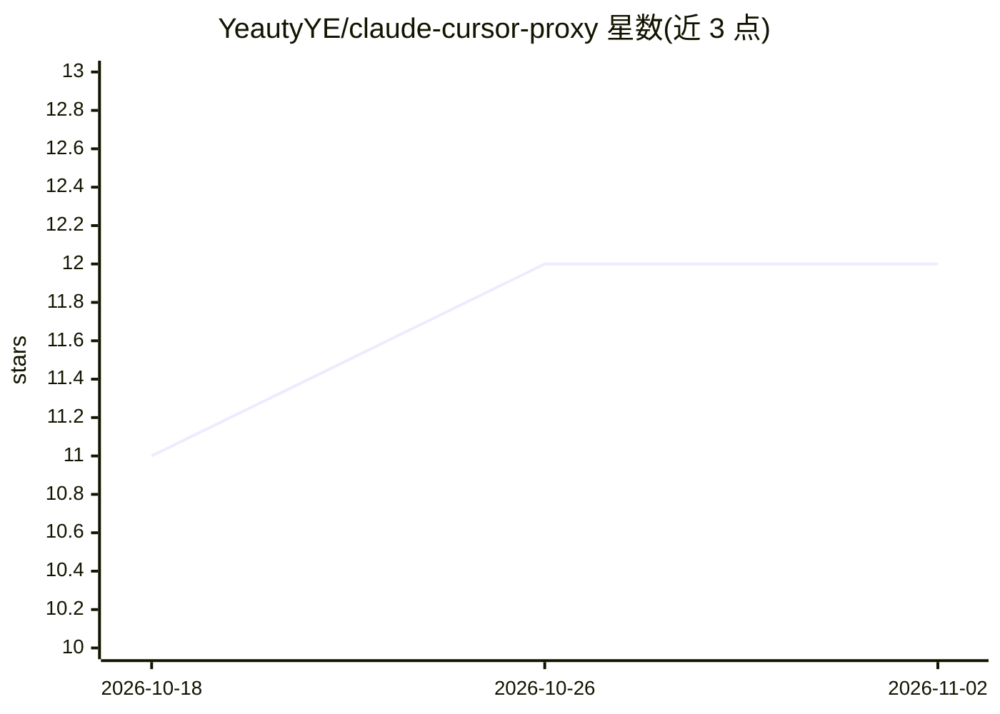

# YeautyYE/claude-cursor-proxy

⭐ 12 · Rust · MIT · 推送 2026-09-08 · [GitHub](https://github.com/YeautyYE/claude-cursor-proxy) · 个人维护 · 中文 README

**本地代理：让 Claude Code 与 grok-build 使用 Cursor（Fable）等模型**

Rust 编写的本地单向代理（默认 127.0.0.1:18765），把 Claude Code 的 Anthropic /v1/messages 请求与 grok-build 的 OpenAI Responses 请求翻译为 Cursor 的 Agent 协议并转发上游，回传匹配的 SSE 流（含 ping 保活）。主上游为 Cursor（Fable 5），同进程附带回退后端 Codex、Kimi、Grok。提供带校验和的二进制安装脚本、多 Cursor 账号池热切换、监控 TUI 与 per-model 的 Sand 路由；自述为尽力而为兼容，非完整 Cursor IDE 镜像，不实现 /v1/chat/completions。改编自 raine/claude-code-proxy。

## 筛选速览

| 维度 | 判定 | 备注 |
|---|---|---|
| AI 角色 | `ai-ecosystem` | LLM/agent 周边工具 |
| 许可风险 | `permissive` | MIT |
| 部署形态 | `desktop` | 安装包/桌面程序 |
| 模型依赖 | locked-api |  |
| 硬件要求 | — | 无带数字的原话,不猜 |
| 安装摩擦 | `low` | 无编译、无系统依赖或容器化 |
| 成熟度 | — | 结构信号不足 |

## 能力要点

- Anthropic /v1/messages 与 OpenAI Responses 双协议入站，翻译为 Cursor Agent 协议
- 同进程多后端：Cursor（Fable 5）为主，另含 Codex、Kimi、Grok
- 多 Cursor 账号池：热切换、per-model 账号绑定、用量查询
- 校验和二进制安装 + 监控 TUI + Sand 模式按模型选择请求面

## 适用场景

- 在 Claude Code 中使用 Cursor 的 Fable 模型
- 让 grok-build 经同一代理接入 Cursor/Grok 模型
- 在多个 Cursor 账号间切换以规避配额限制

## 场景标签

`模型网关` · 领域:Agent 开发

## 证据(README 行号)

> L11: Adapted from raine/claude-code-proxy. This project is a **Cursor-first** local **proxy** for Claude Code and Grok B
> L28: Claude Code speaks Anthropic (`/v1/messages`). grok-build speaks OpenAI Responses (`/v1/responses`). Cursor uses it
> L33: 2. The proxy translates them for Cursor and forwards upstream

## 星数曲线

2026-10-18 11 → 2026-11-02 12（+1）

---
*卡片 v1 · prompt 1.4 · 生成 2026-11-01 · 置信度 high · 依据 README sha `2980702baf46` · [字段定义](../../DATASET.md)*
