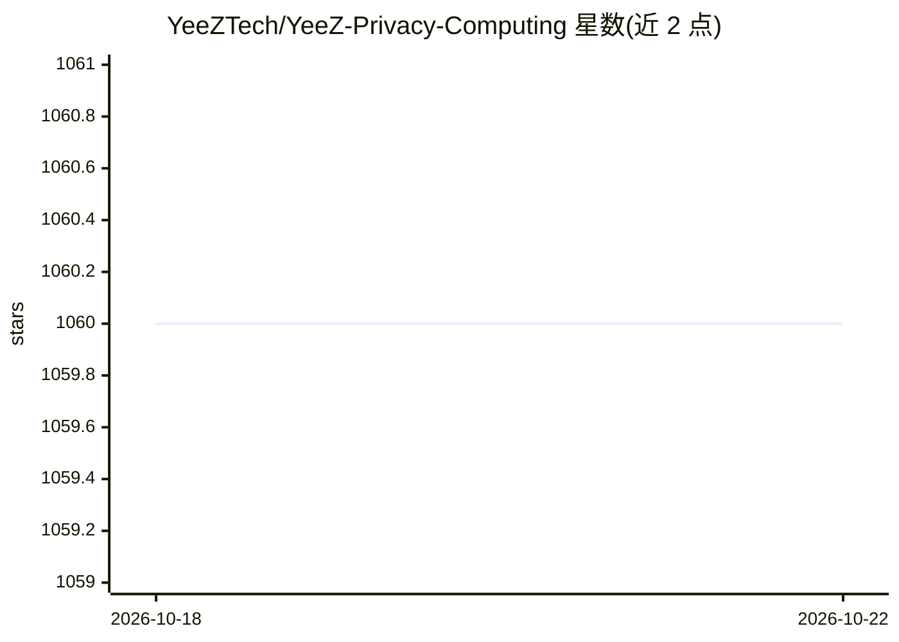

# YeeZTech/YeeZ-Privacy-Computing

⭐ 1,060 · C · GPL-3.0 · 推送 2026-09-02 · [GitHub](https://github.com/YeeZTech/YeeZ-Privacy-Computing) · [官网](http://yeez.tech) · 组织维护 · 中文 README

**基于 Intel SGX 可信执行环境的隐私计算中间件**

Fidelius 是面向数据协作的隐私计算中间件，实践“数据可用不可见”理念：数据提供方与使用方各自运行 Fidelius 中间件，原始数据不离开提供方的中间件，以此保障原始数据一致性、计算逻辑可控、结果正确与隐私保护；可信第三方可选区块链网络，用作可信传输通道与计算验证平台。运行于 Intel SGX 硬件环境，需支持的 CPU、BIOS 设置与驱动软件；无相应硬件时安装 Intel SGX SDK 后可运行 debug 版本。需参照文档自行编译运行。

## 筛选速览

| 维度 | 判定 | 备注 |
|---|---|---|
| AI 角色 | `ai-ecosystem` | LLM/agent 周边工具 |
| 许可风险 | `viral` | GPL-3.0 |
| 部署形态 | `None` |  |
| 模型依赖 | — | README 未给出锁定关系 |
| 硬件要求 | — | 无带数字的原话,不猜 |
| 安装摩擦 | `low` | 无编译、无系统依赖或容器化 |
| 成熟度 | — | 结构信号不足 |

## 能力要点

- 数据提供方/使用方双侧部署的中间件架构，原始数据不出域
- 可信第三方可选用区块链网络做传输通道与计算验证
- 基于 Intel SGX 可信执行环境运行
- 无 SGX 硬件时可装 Intel SGX SDK 运行 debug 版本

## 适用场景

- 两机构间数据协作但原始数据不可外泄的场景
- 需要可信第三方验证计算正确性的数据协作
- 在配备 SGX 的服务器上部署隐私计算中间件

## 场景标签

 · 领域:隐私计算/数据安全基础设施

## 证据(README 行号)

> L8: Fidelius has launched an all-in-one privacy protection solution for data collaboration based on the idea of "data av
> L10: The following figure describes the abstract process of data collaboration based on Fidelius. The participants inclu

## 星数曲线

2026-10-18 1,060 → 2026-10-22 1,060（+0）

---
*卡片 v1 · prompt 1.4 · 生成 2026-10-21 · 置信度 mid · 依据 README sha `02d9fe8ac8d8` · [字段定义](../../DATASET.md)*
