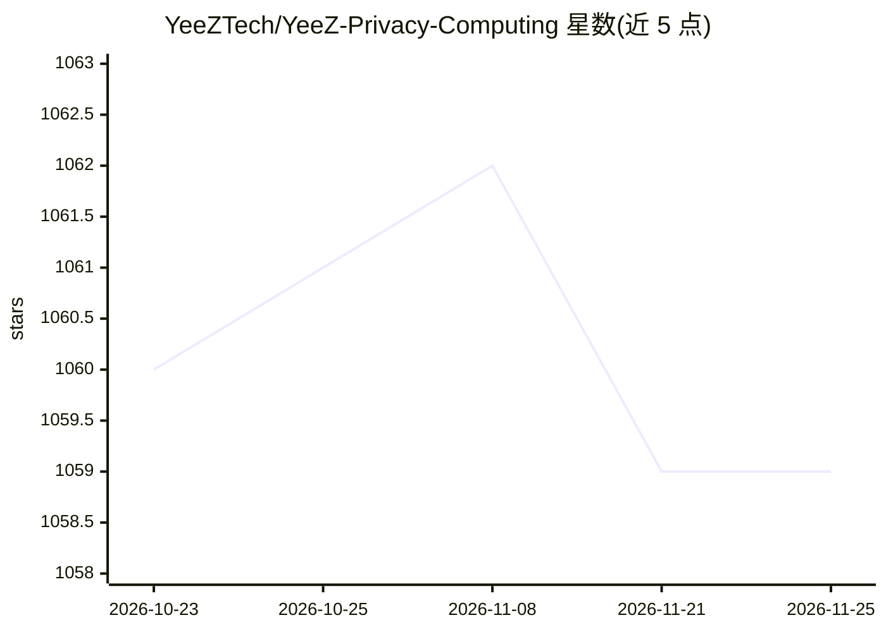

# YeeZTech/YeeZ-Privacy-Computing

⭐ 1,059 · C++ · GPL-3.0 · 推送 2026-11-13 · [GitHub](https://github.com/YeeZTech/YeeZ-Privacy-Computing) · [官网](http://yeez.tech) · 组织维护 · 中文 README

**基于可信执行环境的数据协作隐私保护中间件**

Fidelius 是一款围绕"数据可用不可见"理念的隐私计算中间件，部署在数据提供方与数据使用方两侧，双方通过它完成数据协作，原始数据不离开提供方的中间件实例。方案可选用区块链网络作为可信第三方，充当可信传输通道与计算结果验证平台。运行依赖 Intel SGX 硬件环境（CPU、BIOS 设置、驱动），无对应硬件时可安装 Intel SGX SDK 运行 debug 版本；需参照文档编译运行，主体代码采用 Apache 2.0 许可。

## 筛选速览

| 维度 | 判定 | 备注 |
|---|---|---|
| AI 角色 | `ai-enhanced` | 去掉 AI 部分产品仍成立 |
| 许可风险 | `viral` | GPL-3.0 |
| 部署形态 | `None` |  |
| 模型依赖 | — | README 未给出锁定关系 |
| 硬件要求 | — | 无带数字的原话,不猜 |
| 安装摩擦 | `low` | 无编译、无系统依赖或容器化 |
| 成熟度 | — | 结构信号不足 |

## 能力要点

- 数据提供方与使用方两侧部署中间件完成协作，原始数据不出提供方侧
- 可选用区块链作为可信第三方，用于传输通道与计算验证
- 基于 Intel SGX 可信执行环境，无硬件时可运行 debug 版本
- 相关论文发表于 ACM International Symposium on Blockchain and Secure Critical Infrastructure (2025)

## 适用场景

- 两方在原始数据互不外泄的前提下开展数据协作计算
- 需要保障计算逻辑可控与计算结果正确性的数据合作
- 结合区块链做数据协作的可信传输与结果验证

## 场景标签

 · 领域:隐私计算/数据安全

## 证据(README 行号)

> L8: Fidelius has launched an all-in-one privacy protection solution for data collaboration based on the idea of "data av
> L32: Fidelius runs on Intel SGX and requires confirmation that the hardware environment is equipped with a supported cen

## 星数曲线

2026-10-23 1,060 → 2026-11-25 1,059（-1）

---
*卡片 v1 · prompt 1.4 · 生成 2026-11-24 · 置信度 mid · 依据 README sha `3ab8f9ff3aac` · [字段定义](../../DATASET.md)*
