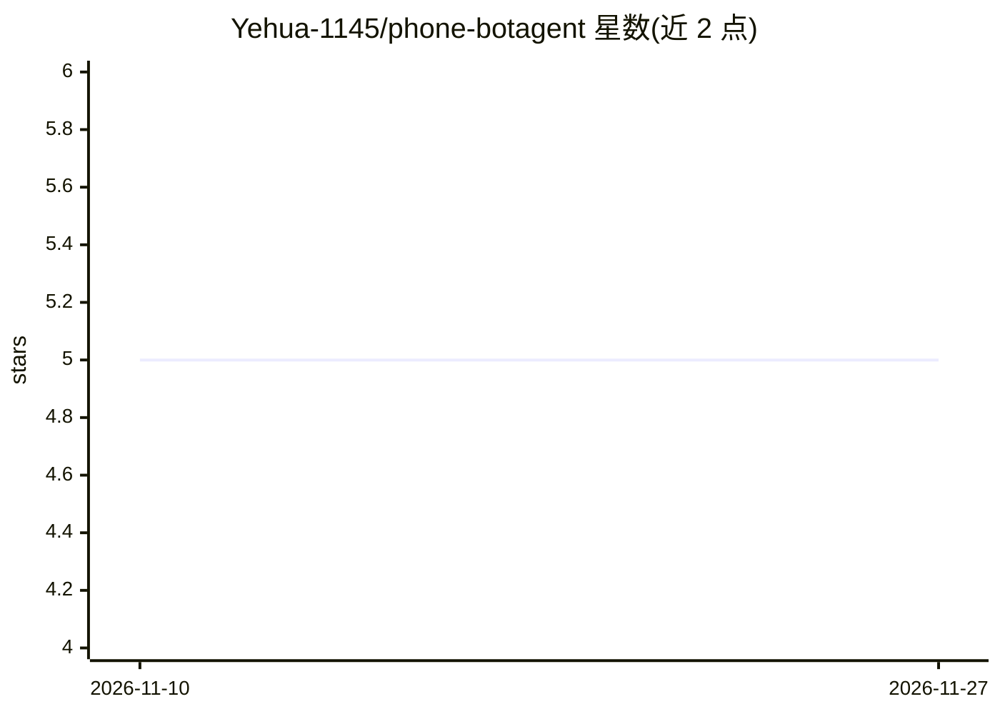

# Yehua-1145/phone-botagent

⭐ 5 · Python · MIT · 推送 2026-11-15 · [GitHub](https://github.com/Yehua-1145/phone-botagent) · [官网](https://yehua-1145.github.io/-QQbot-/) · 个人维护 · 中文 README

**把闲置安卓手机变成可接入 QQ 的 AI 助手机器人**

由三部分组成：运行在手机 Termux 里的 Botagent 服务（收发 QQ、调用大模型、执行工具、管理图库）、手机上的控制台 App（对话、切换模型、编辑人设、重启服务），以及 Windows 一键部署工具（通过 adb 自动安装 Termux、推送配置并启动）。支持私聊、群聊 @ 触发、流式输出、上下文与长期记忆；root 或无障碍服务开启后可执行读屏、点按、截图等界面自动化操作。依赖 NapCat 与 Linux QQ 协议端，README 提示存在封号风险且上游机制变更可能失效。

## 筛选速览

| 维度 | 判定 | 备注 |
|---|---|---|
| AI 角色 | `ai-native` | 本体是模型或模型工具 |
| 许可风险 | `permissive` | MIT |
| 部署形态 | `desktop` | 安装包/桌面程序 |
| 模型依赖 | local-ok | 支持本地模型 |
| 硬件要求 | — | 无带数字的原话,不猜 |
| 安装摩擦 | `low` | 无编译、无系统依赖或容器化 |
| 成熟度 | `idea` | |

## 能力要点

- 多服务商接入：DeepSeek / OpenAI / 通义千问 / 本地 Ollama / OpenAI 兼容接口
- 无 root 时通过无障碍服务实现读界面、点按、输入、截图（Android 11+）
- 有 root 时提供 ui_dump/ui_tap 等界面自动化工具与 OCR 回退
- Windows 一键部署：adb 自动装 Termux、推配置、生成 token

## 适用场景

- 用闲置安卓手机在 QQ 里搭一个私人 AI 聊天机器人
- 让 AI 通过对话执行手机操作，如截图、打开应用、查电量
- 定时自动抓图填图库并每日换新

## 场景标签

`聊天机器人` `GUI 自动化` · 领域:效率与自动化

## 证据(README 行号)

> L104: |**Botagent 服务**|手机 Termux|收发 QQ、调大模型、跑工具、管理图库|
> L114: - **多服务商**：DeepSeek / OpenAI / 通义千问 / 本地 Ollama / 任何 OpenAI 兼容接口
> L501: **边界（很重要）**：

## 星数曲线

2026-11-10 5 → 2026-11-27 5（+0）

---
*卡片 v1 · prompt 1.4 · 生成 2026-11-21 · 置信度 high · 依据 README sha `70e11c9f34b1` · [字段定义](../../DATASET.md)*
