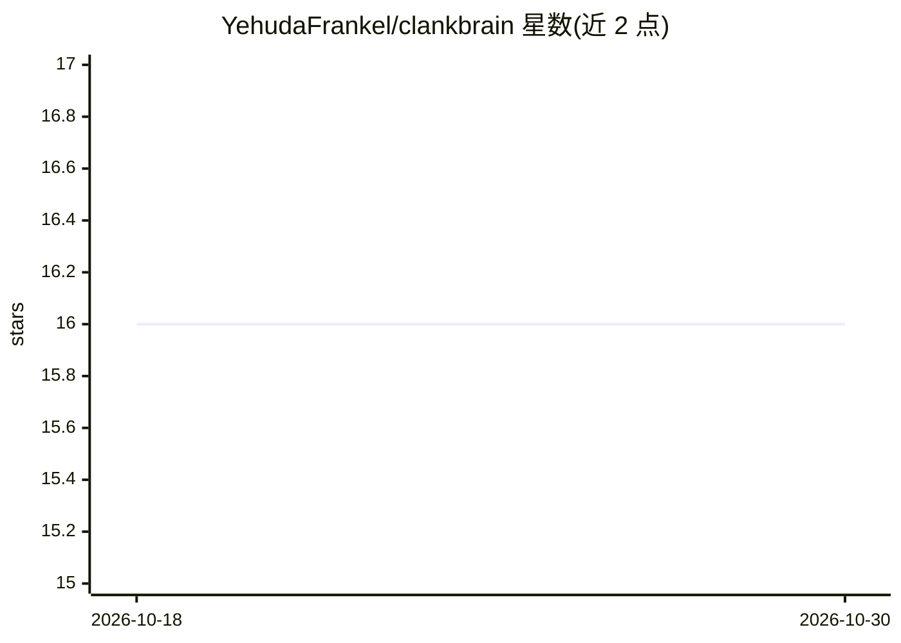

# YehudaFrankel/clankbrain

⭐ 16 · Python · MIT · 推送 2026-10-18 · [GitHub](https://github.com/YehudaFrankel/clankbrain) · [官网](https://clankbrain.vercel.app) · 个人维护

**给 Claude Code 的开箱即用记忆与工作流套件**

运行在 Claude Code（或 Codex）之上的配置套件：通过 npx 安装器部署预置的 hooks、Markdown 记忆文件（lessons/decisions/errors/regret 等）、Start/End Session 例程及默认 19 个核心工作流（仓库共 36 个）。Hooks 在会话开始、纠错、文件编辑、上下文压缩等时刻自动记录与核对记忆；技能带评分，可由 /evolve 按失败历史重写。支持通过私有 git 仓库在团队间共享条目，可选 sentence-transformers 实现语义检索。Hooks 与技能仅在 Claude Code 中生效，Cursor/Windsurf 只生成规则文件，Copilot 不支持。

## 筛选速览

| 维度 | 判定 | 备注 |
|---|---|---|
| AI 角色 | `ai-ecosystem` | LLM/agent 周边工具 |
| 许可风险 | `permissive` | MIT |
| 部署形态 | `library` | 以包/库形式分发 |
| 模型依赖 | locked-api |  |
| 硬件要求 | — | 无带数字的原话,不猜 |
| 安装摩擦 | `low` | 无编译、无系统依赖或容器化 |
| 成熟度 | — | 结构信号不足 |

## 能力要点

- 预置 hooks：捕获纠错、核对笔记时效、压缩时保护记忆、写会话日志
- Markdown 记忆文件体系（lessons/decisions/errors/regret/STATUS），可 git 跟踪
- 19 个默认核心工作流（仓库 36 个），技能带评分并可用 /evolve 重写
- Lite/Full 两档安装，团队可经自有私有仓库共享条目

## 适用场景

- 让 Claude Code 在多次会话间积累教训与决策记录
- 为长期维护的项目建立可读可编辑的 AI 记忆文件
- 团队成员间共享踩坑记录与修复方案
- 用 Start/End Session 例程衔接日常工作流

## 场景标签

`Agent 记忆` `工作流自动化` · 领域:Agent 开发

## 证据(README 行号)

> L9: **Clankbrain is a ready-made setup for Claude Code.** It adds automatic hooks, organized memory files, a start-and-e
> L27: |A hook system you configure yourself|Hooks already wired: they catch your corrections and turn them into lessons, 

## 星数曲线

2026-10-18 16 → 2026-10-30 16（+0）

---
*卡片 v1 · prompt 1.4 · 生成 2026-10-30 · 置信度 high · 依据 README sha `f3c589ac8086` · [字段定义](../../DATASET.md)*
