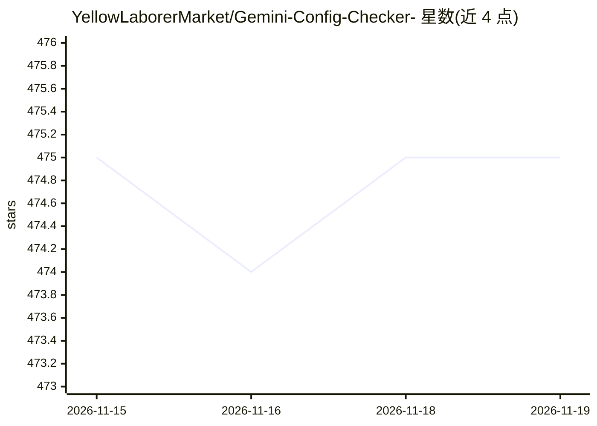

# YellowLaborerMarket/Gemini-Config-Checker-

⭐ 475 · Makefile · Apache-2.0 · 推送 2026-11-15 · [GitHub](https://github.com/YellowLaborerMarket/Gemini-Config-Checker-) · 个人维护

**检测代理配置能否真正进入 Google AI Studio 与 Gemini 的扫描工具**

面向需要经代理访问 Google AI Studio / Gemini 的用户：逐条测试 vless/vmess/trojan/ss 等代理配置，通过已登录浏览器读取 Google 的区域判定（区分连通性与区域封锁）。提供 Simple / Advanced 两种模式，Advanced 可将免费配置链在一个可用基础配置之后更换出口。内置基于 Xray-core 的引擎与可编辑的 anti-DPI 参数（Finalmask 分片、指纹、ALPN、密码套件）。以 Wails 桌面应用（Windows/macOS/Linux/Android APK）与 Web 服务器两种形态分发。自述为 0.1.0 早期预发布，仅 Windows 经过端到端实测；区域检测需本机装有 Chrome/Edge/Brave，Android 仅支持连通性模式。

## 筛选速览

| 维度 | 判定 | 备注 |
|---|---|---|
| AI 角色 | `ai-enhanced` | 去掉 AI 部分产品仍成立 |
| 许可风险 | `permissive` | Apache-2.0 |
| 部署形态 | `desktop` | 安装包/桌面程序 |
| 模型依赖 | — | README 未给出锁定关系 |
| 硬件要求 | — | 无带数字的原话,不猜 |
| 安装摩擦 | `medium` | 含编译或系统依赖之一 |
| 成熟度 | `idea` | |

## 能力要点

- 以已登录浏览器读取 Google 对 AI Studio / Gemini 的区域判定，而非单纯 HTTP 连通性探测
- Simple / Advanced 双模式，Advanced 支持基础配置+免费配置的链式出口测试
- 可编辑的 anti-DPI 配置（Finalmask 分片、指纹、ALPN、密码套件），本地转发器实现分段分片算法
- 结果按 AI Studio 与 Gemini 分列显示区域封锁状态，可导出链接、base64 或 Xray 配置

## 适用场景

- 验证手头一批代理配置哪些能真正打开 AI Studio / Gemini
- Cloudflare 配置能连但被 Google 区域封锁时，测试链式免费配置换出口
- 扫描前用 anti-DPI 配置在过滤网络中建立连接

## 场景标签

 · 领域:网络工具/代理配置检测

## 证据(README 行号)

> L11: Find proxy configs that actually get you into **Google AI Studio and Gemini**, by testing each one the way a person
> L50: Google decides region availability **per signed-in account, after the page has loaded**. A plain HTTP request (even

## 星数曲线

2026-11-15 475 → 2026-11-19 475（+0）

---
*卡片 v1 · prompt 1.4 · 生成 2026-11-17 · 置信度 high · 依据 README sha `846e83cebb20` · [字段定义](../../DATASET.md)*
