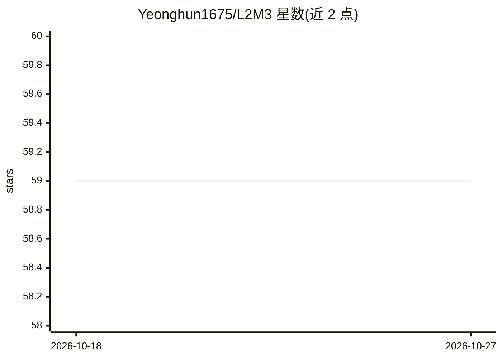

# Yeonghun1675/L2M3

⭐ 59 · Jupyter Notebook · MIT · 推送 2026-03-21 · [GitHub](https://github.com/Yeonghun1675/L2M3) · [官网](https://pubs.acs.org/doi/10.1021/jacs.4c11085) · 组织维护

**用 LLM 链从文献中提取 MOF 材料数据的文本挖掘工具**

面向材料科学机器学习数据获取需求的 LLM 文本挖掘工具：通过分类、包含性判断、结构化提取三个专用 Agent，从科研论文的表格与正文中抽取金属有机框架（MOF）的合成条件与物性数据，输出结构化 JSON。配套 JournalReader 解析 XML/HTML（支持 ACS/RSC/Elsevier/Springer 四家出版商），另提供 token 用量与费用估算工具及微调数据集与脚本。默认使用 OpenAI API（gpt-4/gpt-3.5-turbo-16k），需提供 API key；主要在 Linux 测试，Python ≥3.9，git clone 后 pip 可编辑安装。

## 筛选速览

| 维度 | 判定 | 备注 |
|---|---|---|
| AI 角色 | `ai-native` | 本体是模型或模型工具 |
| 许可风险 | `permissive` | MIT |
| 部署形态 | `library` | 以包/库形式分发 |
| 模型依赖 | — | README 未给出锁定关系 |
| 硬件要求 | — | 无带数字的原话,不猜 |
| 安装摩擦 | `low` | 无编译、无系统依赖或容器化 |
| 成熟度 | — | 结构信号不足 |

## 能力要点

- 三 Agent 流水线：分类→包含性判断→结构化 JSON 提取
- JournalReader 解析 ACS/RSC/Elsevier/Springer 的 XML/HTML 论文
- 已从 40,000+ 篇论文汇编 MOF 合成条件与物性数据集
- 提供微调数据集（7 类 jsonl）与微调脚本以降低 token 成本

## 适用场景

- 批量从论文表格和正文中抽取 MOF 合成条件与性质数据
- 为材料科学机器学习构建结构化数据集
- 估算文本挖掘任务的 token 用量与费用

## 场景标签

`科研工具` `文档解析` · 领域:知识与检索

## 证据(README 行号)

> L4: L2M3 is designed to efficiently gather experimental Metal-Organic Framework (MOF) data from scientific literature, a
> L8: L2M3 employs three specialized agents:
> L66: ### 2. LLMMiner (Agent)

## 星数曲线

2026-10-18 59 → 2026-10-27 59（+0）

---
*卡片 v1 · prompt 1.4 · 生成 2026-10-24 · 置信度 mid · 依据 README sha `96b33730febc` · [字段定义](../../DATASET.md)*
