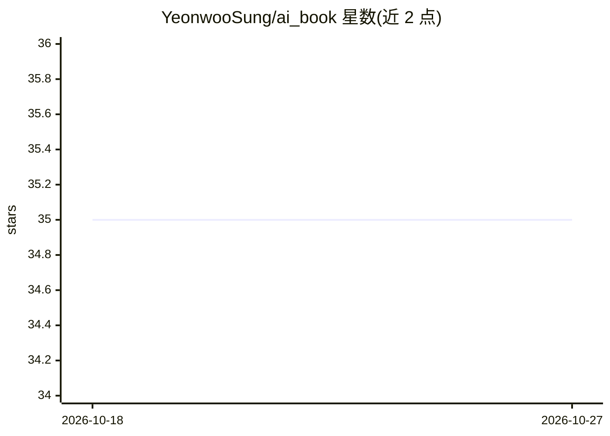

# YeonwooSung/ai_book

⭐ 35 · Jupyter Notebook · 推送 2026-04-08 · [GitHub](https://github.com/YeonwooSung/ai_book) · 个人维护

**面向大众的免费 AI 在线学习书籍**

一个名为 AI Book 的免费在线人工智能书籍项目，定位是帮助人们更容易地学习 AI。README 仅给出标题、简介与 Table of Contents、Contributing 章节框架，目录与贡献细则内容未展开，未说明具体章节内容、构建方式或运行方法。仓库主题标签涉及 CV、deep-learning、llama、LLM、LLMOps、knowledge-distillation、MLOps 等方向。以 GitHub 仓库形式提供，可在线阅读或贡献。

## 筛选速览

| 维度 | 判定 | 备注 |
|---|---|---|
| AI 角色 | `ai-knowledge` | 知识聚合/清单类 |
| 许可风险 | `none` | — |
| 部署形态 | `None` |  |
| 模型依赖 | — | README 未给出锁定关系 |
| 硬件要求 | — | 无带数字的原话,不猜 |
| 安装摩擦 | `low` | 无编译、无系统依赖或容器化 |
| 成熟度 | — | 结构信号不足 |

## 能力要点

- 免费在线 AI 学习书籍
- 含目录与贡献指南的项目结构
- 主题覆盖 CV/LLM/LLMOps/MLOps 等方向（据仓库标签）

## 适用场景

- 作为入门 AI 的免费在线阅读材料
- 通过 Contributing 流程参与内容补充

## 场景标签

`教程课程` · 领域:学习与行业

## 证据(README 行号)

> L3: Free online book on Artificial Intelligence to help people learn AI easily.

## 星数曲线

2026-10-18 35 → 2026-10-27 35（+0）

---
*卡片 v1 · prompt 1.4 · 生成 2026-10-25 · 置信度 low · 依据 README sha `43ca198ca1a6` · [字段定义](../../DATASET.md)*
