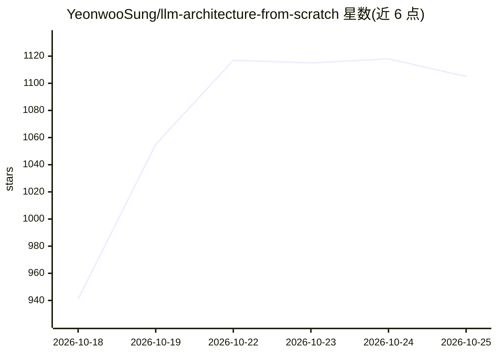

# YeonwooSung/llm-architecture-from-scratch

⭐ 1,105 · Python · BSD-3-Clause · 推送 2026-10-25 · [GitHub](https://github.com/YeonwooSung/llm-architecture-from-scratch) · 个人维护

**用 PyTorch 从零复现主流 LLM 架构的教学实现合集**

以 PyTorch 从零实现现代 LLM 架构的代码集合，用于深入理解各模型结构。已实现 13 种架构（GPT-2 XL、Llama3 系列、Phi-4、DeepSeek v3、Gemma 3、xLSTM、Qwen3 等），并以表格记录各实现的参数规模、归一化方式、位置编码、注意力机制与是否含 MoE 等结构特征；部分为多模态（文本+图像）。另有 Kimi K2、GLM 4.5、GPT OSS 120B、Grok 2.5、Qwen3 Next 标注为实现中。README 未给出安装与运行命令。

## 筛选速览

| 维度 | 判定 | 备注 |
|---|---|---|
| AI 角色 | `ai-native` | 本体是模型或模型工具 |
| 许可风险 | `permissive` | BSD-3-Clause |
| 部署形态 | `None` |  |
| 模型依赖 | — | README 未给出锁定关系 |
| 硬件要求 | — | 无带数字的原话,不猜 |
| 安装摩擦 | `low` | 无编译、无系统依赖或容器化 |
| 成熟度 | — | 结构信号不足 |

## 能力要点

- 已实现 13 种 LLM 架构，覆盖 1.5B 至 671B 参数规模
- 表格记录各架构的归一化、位置编码、注意力与 MoE 结构差异
- 包含 DeepSeek v3、Llama 4、Qwen3-235B 等 MoE 架构实现
- 覆盖多模态架构（Gemma 3、Mistral 3.1 Small）与 xLSTM

## 适用场景

- 对照源码学习 Llama/DeepSeek/Qwen 等模型的内部结构
- 研究 MoE、GQA、滑动窗口注意力等机制的参考实现
- 比较不同 LLM 架构在归一化与位置编码上的设计差异

## 场景标签

`教程课程` · 领域:学习与行业

## 证据(README 行号)

> L3: Implementing LLM architectures from scratch for deep understanding of modern LLM architectures.
> L7: |Model|Model Size|Modality|Normalization|Positional Encoding|Attention|Mixture of Experts|

## 星数曲线

2026-10-18 941 → 2026-10-25 1,105（+164）

---
*卡片 v1 · prompt 1.4 · 生成 2026-10-21 · 置信度 mid · 依据 README sha `ab3810b9cf85` · [字段定义](../../DATASET.md)*
