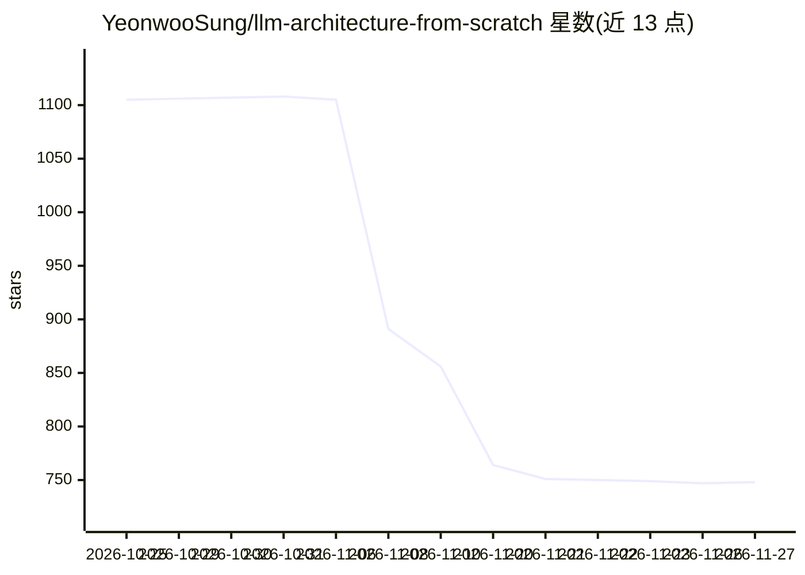

# YeonwooSung/llm-architecture-from-scratch

⭐ 748 · Python · BSD-3-Clause · 推送 2026-11-19 · [GitHub](https://github.com/YeonwooSung/llm-architecture-from-scratch) · 个人维护

**为学习者用 PyTorch 从零实现现代 LLM 架构**

教学/研究性质的代码集合：以 PyTorch 逐个复现 20 余种现代 LLM 的架构，涵盖 GPT-2、Llama 系列、Gemma 3、DeepSeek v3、Qwen3、Kimi K2 等，并以表格记录各模型的规模、模态、归一化方式、位置编码、注意力机制与 MoE 配置，便于对照学习架构设计。README 未提供安装与使用命令，属代码阅读型项目。

## 筛选速览

| 维度 | 判定 | 备注 |
|---|---|---|
| AI 角色 | `ai-knowledge` | 知识聚合/清单类 |
| 许可风险 | `permissive` | BSD-3-Clause |
| 部署形态 | `None` |  |
| 模型依赖 | — | README 未给出锁定关系 |
| 硬件要求 | — | 无带数字的原话,不猜 |
| 安装摩擦 | `low` | 无编译、无系统依赖或容器化 |
| 成熟度 | — | 结构信号不足 |

## 能力要点

- 用 PyTorch 从零复现 20+ 现代主流 LLM 架构
- 表格对照各模型的归一化、位置编码、注意力与 MoE 配置
- 覆盖 DeepSeek MLA、滑动窗口注意力、GQA 等机制
- 含进行中的架构实现章节

## 适用场景

- 逐个学习现代 LLM 架构组件的实现细节
- 对比不同模型在位置编码、注意力机制上的设计差异
- 作为复现模型的参考代码

## 场景标签

`教程课程` · 领域:学习与行业

## 证据(README 行号)

> L5: Implementing LLM architectures from scratch for deep understanding of modern LLM architectures.
> L7: ## Implemented

## 星数曲线

2026-10-25 1,105 → 2026-11-27 748（-357）

---
*卡片 v1 · prompt 1.4 · 生成 2026-11-24 · 置信度 high · 依据 README sha `84c440e22cda` · [字段定义](../../DATASET.md)*
