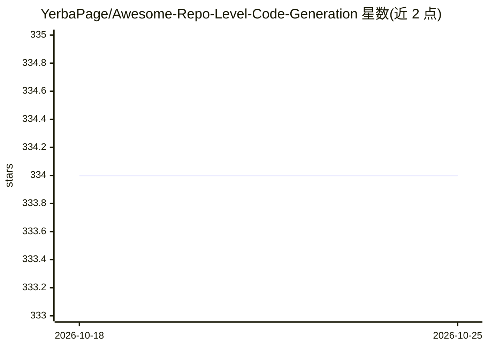

# YerbaPage/Awesome-Repo-Level-Code-Generation

⭐ 335 · MIT · 推送 2026-10-21 · [GitHub](https://github.com/YerbaPage/Awesome-Repo-Level-Code-Generation) · 组织维护

**仓库级代码生成与议题修复论文策展清单**

由上海交大研究者维护的 awesome list，收录仓库级（repository-level）代码生成与议题修复方向的研究论文，按 Repo-Level Issue Resolution 与 Repo-Level Code Completion 等章节组织，时间跨度 2023 至 2026，多为 arXiv 论文并附会议出处；部分条目附带论文链接与代码仓库链接。面向软件工程与 LLM 方向的研究者和开发者，可通过 PR 贡献新条目。内容为清单本体，不含可运行代码。

## 筛选速览

| 维度 | 判定 | 备注 |
|---|---|---|
| AI 角色 | `ai-knowledge` | 知识聚合/清单类 |
| 许可风险 | `permissive` | MIT |
| 部署形态 | `None` |  |
| 模型依赖 | — | README 未给出锁定关系 |
| 硬件要求 | — | 无带数字的原话,不猜 |
| 安装摩擦 | `low` | 无编译、无系统依赖或容器化 |
| 成熟度 | — | 结构信号不足 |

## 能力要点

- 按议题修复/代码补全等章节组织的论文清单
- 覆盖 2023-2026 年 arXiv 与会议论文（EMNLP/NeurIPS/ASE 等）
- 部分条目附代码仓库链接

## 适用场景

- 查找仓库级代码生成方向的论文与代码
- 跟踪 SWE agent 与自动程序修复的研究进展
- 为选型或研究综述收集参考文献

## 场景标签

`精选清单` · 领域:学习与行业

## 证据(README 行号)

> L3: 🌟 A curated list of awesome repository-level code generation research papers and resources. If you want to contribut
> L9: ## 💥 Repo-Level Issue Resolution
> L89: ## 🤖 Repo-Level Code Completion

## 星数曲线

2026-10-18 334 → 2026-10-25 334（+0）

---
*卡片 v1 · prompt 1.4 · 生成 2026-10-22 · 置信度 high · 依据 README sha `b41a09c4fa49` · [字段定义](../../DATASET.md)*
