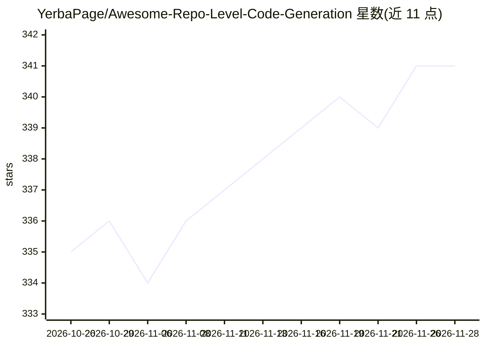

# YerbaPage/Awesome-Repo-Level-Code-Generation

⭐ 341 · MIT · 推送 2026-11-22 · [GitHub](https://github.com/YerbaPage/Awesome-Repo-Level-Code-Generation) · 个人维护

**面向 AI4SE 研究者的仓库级代码生成论文清单**

由 SJTU 研究者维护的策展清单（curated list），收录仓库级代码生成与 Issue Resolution 方向的研究论文及资源，按 Issue Resolution、Code Completion 等类别组织，条目标注发表会议/arXiv 时间并提供论文与代码仓库链接，接受社区 pull request 贡献。清单本身不包含可运行代码或工具，属于文献导航资源，适用于跟踪 SWE-agent、程序修复、代码补全等研究的进展。

## 筛选速览

| 维度 | 判定 | 备注 |
|---|---|---|
| AI 角色 | `ai-knowledge` | 知识聚合/清单类 |
| 许可风险 | `permissive` | MIT |
| 部署形态 | `None` |  |
| 模型依赖 | — | README 未给出锁定关系 |
| 硬件要求 | — | 无带数字的原话,不猜 |
| 安装摩擦 | `low` | 无编译、无系统依赖或容器化 |
| 成熟度 | — | 结构信号不足 |

## 能力要点

- 收录仓库级代码生成与 Issue Resolution 方向研究论文
- 按 Issue Resolution、Code Completion 等类别组织条目
- 条目附论文与代码仓库链接，标注会议/arXiv 时间
- 接受社区 pull request 补充

## 适用场景

- 查找仓库级代码生成方向的论文入口
- 跟踪 SWE-agent 与自动程序修复研究进展
- 为 AI4SE 综述或课题调研收集文献

## 场景标签

`精选清单` `科研工具` · 领域:学习与行业

## 证据(README 行号)

> L3: 🌟 A curated list of awesome repository-level code generation research papers and resources. If you want to contribut
> L9: ## 💥 Repo-Level Issue Resolution

## 星数曲线

2026-10-26 335 → 2026-11-28 341（+6）

---
*卡片 v1 · prompt 1.4 · 生成 2026-11-25 · 置信度 high · 依据 README sha `2c04c8c6c49f` · [字段定义](../../DATASET.md)*
