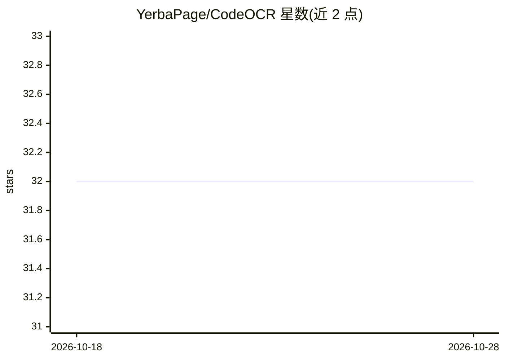

# YerbaPage/CodeOCR

⭐ 32 · Python · 推送 2026-02-02 · [GitHub](https://github.com/YerbaPage/CodeOCR) · 组织维护

**论文官方实现：把源码渲染成图像供 MLLM 理解代码**

ISSTA 2026 论文 'Seeing is Coding' 的官方实现：研究将源码渲染为图像，通过“光学压缩”探索视觉语言模型在代码理解任务上的效果。提供代码渲染工具（Python API 与 CLI，支持语法高亮与主题），通过 OpenRouter/Azure OpenAI 等 API 调用 gpt-4o 等模型，在代码补全（RAG）、代码问答、克隆检测、摘要与代码重建等下游任务上运行实验。需要 Python≥3.10，建议 NVIDIA CUDA GPU（≥4GB VRAM）用于本地嵌入模型。

## 筛选速览

| 维度 | 判定 | 备注 |
|---|---|---|
| AI 角色 | `ai-knowledge` | 知识聚合/清单类 |
| 许可风险 | `none` | — |
| 部署形态 | `library` | 以包/库形式分发 |
| 模型依赖 | locked-api |  |
| 硬件要求 | `gpu-8g` | |
| 安装摩擦 | `medium` | 含编译或系统依赖之一 |
| 成熟度 | — | 结构信号不足 |

## 能力要点

- 源码渲染为图像的渲染工具，含 Python API 与 CLI
- 覆盖代码补全、QA、克隆检测、摘要、重建五类下游实验
- 支持 OpenRouter 与 Azure OpenAI API 凭据配置
- 本地嵌入模型 unixcoder-base 与 Qwen tokenizer/processor

## 适用场景

- 复现论文中的 MLLM 代码理解实验
- 把代码文件渲染成带语法高亮的图像
- 研究图像化代码表示的效率与效果

## 场景标签

`多模态` `科研工具` · 领域:学习与行业

## 证据(README 行号)

> L1: # CodeOCR: On the Effectiveness of Vision Language Models in Code Understanding
> L3: This repository contains the official implementation for the paper **"Seeing is Coding: On the Effectiveness of Visi
> L7: Large Language Models (LLMs) have achieved remarkable success in source code understanding, yet as software systems 

## 星数曲线

2026-10-18 32 → 2026-10-28 32（+0）

---
*卡片 v1 · prompt 1.4 · 生成 2026-10-26 · 置信度 high · 依据 README sha `abfd50e12247` · [字段定义](../../DATASET.md)*
