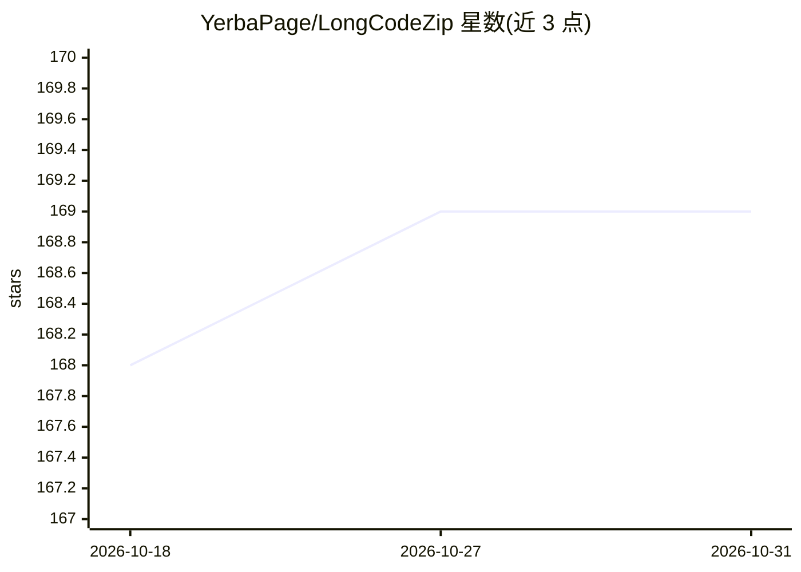

# YerbaPage/LongCodeZip

⭐ 169 · Python · MIT · 推送 2026-05-12 · [GitHub](https://github.com/YerbaPage/LongCodeZip) · 组织维护

**面向代码 LLM 的两阶段长代码压缩方法（ASE 2025 论文实现）**

ASE 2025 论文 LongCodeZip 的官方实现，提供即插即用的长代码压缩框架：第一阶段基于函数分块与条件困惑度排序做粗粒度压缩，第二阶段用熵块检测结合 0/1 背包优化在自适应 token 预算内做细粒度压缩，可接入既有代码 LLM。以 Python 包形式安装，附带 demo.py 演示两种压缩模式，默认用 Qwen2.5-Coder-7B-Instruct 生成，也可切换 OpenAI API。

## 筛选速览

| 维度 | 判定 | 备注 |
|---|---|---|
| AI 角色 | `ai-ecosystem` | LLM/agent 周边工具 |
| 许可风险 | `permissive` | MIT |
| 部署形态 | `library` | 以包/库形式分发 |
| 模型依赖 | — | README 未给出锁定关系 |
| 硬件要求 | — | 无带数字的原话,不猜 |
| 安装摩擦 | `low` | 无编译、无系统依赖或容器化 |
| 成熟度 | — | 结构信号不足 |

## 能力要点

- 两阶段压缩：函数分块+条件困惑度排序，熵块检测+背包优化
- 即插即用，可与既有代码 LLM 集成
- demo.py 支持 Qwen2.5-Coder 与 OpenAI API 两种生成模型

## 适用场景

- 我需要在 token 预算内把长代码文件压缩后交给代码 LLM 处理
- 我想在代码生成任务中降低长上下文的 token 消耗
- 我想复现或扩展 ASE 2025 论文的压缩方法

## 场景标签

 · 领域:软件工程/代码 LLM

## 证据(README 行号)

> L7: This repository is the official implementation of LongCodeZip, a novel two-stage long code compression method. Our p
> L19: The method is plug-and-play and can be integrated with existing code LLMs to achieve significant compression ratios

## 星数曲线

2026-10-18 168 → 2026-10-31 169（+1）

---
*卡片 v1 · prompt 1.4 · 生成 2026-10-23 · 置信度 high · 依据 README sha `3244f37046dc` · [字段定义](../../DATASET.md)*
