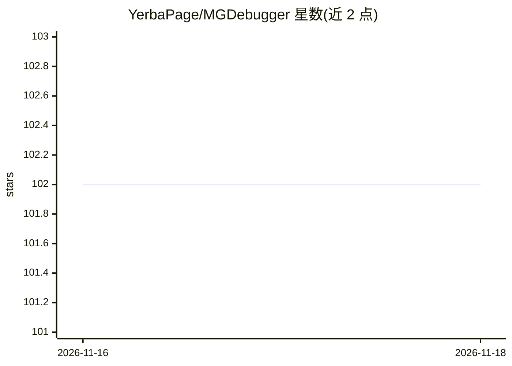

# YerbaPage/MGDebugger

⭐ 102 · Python · MIT · 推送 2026-11-15 · [GitHub](https://github.com/YerbaPage/MGDebugger) · 组织维护

**分层多粒度的 LLM 代码调试方法，修复生成代码错误**

ICSE2026 论文配套的层次化 LLM 调试工具：自底向上从子函数到整体系统逐层隔离、定位并修复代码错误，开发者可用其调试复杂代码与函数，减少调试时间。依赖 vLLM（≥0.6.0）加载与推理模型（示例使用 DeepSeek-Coder-V2-Lite-Instruct），通过 pip 安装依赖后启动 vLLM 服务，运行 demo.py 或 main.py；调试与错误日志存于 output_data 目录。论文报告在 HumanEval 上准确率 94.5%、DeepSeek-R1 下达 100%（实验结果）。

## 筛选速览

| 维度 | 判定 | 备注 |
|---|---|---|
| AI 角色 | `ai-native` | 本体是模型或模型工具 |
| 许可风险 | `permissive` | MIT |
| 部署形态 | `library` | 以包/库形式分发 |
| 模型依赖 | local-ok | 支持本地模型 |
| 硬件要求 | — | 无带数字的原话,不猜 |
| 安装摩擦 | `low` | 无编译、无系统依赖或容器化 |
| 成熟度 | — | 结构信号不足 |

## 能力要点

- 层次化自底向上调试：从子函数到整体系统逐级定位修复
- 依赖 vLLM 服务进行模型加载与推理，模型可经 config.py 更换
- 自动存储全部调试与错误日志到 output_data 目录
- 配套论文与实验代码（HumanEval/MBPP 基准）

## 适用场景

- 调试与修复 LLM 生成的复杂代码
- 复现论文在 HumanEval/MBPP 上的调试实验
- 在代码生成流程中加入分层错误定位与修复环节

## 场景标签

`编码 Agent` · 领域:编码与开发

## 证据(README 行号)

> L16: MGDebugger is a hierarchical LLM code debugging method designed to isolate, identify, and resolve errors at various
> L43: To launch the vLLM server with the `DeepSeek-Coder-V2-Lite-Instruct` model, execute the following command:

## 星数曲线

2026-11-16 102 → 2026-11-18 102（+0）

---
*卡片 v1 · prompt 1.4 · 生成 2026-11-17 · 置信度 high · 依据 README sha `10b4562290aa` · [字段定义](../../DATASET.md)*
