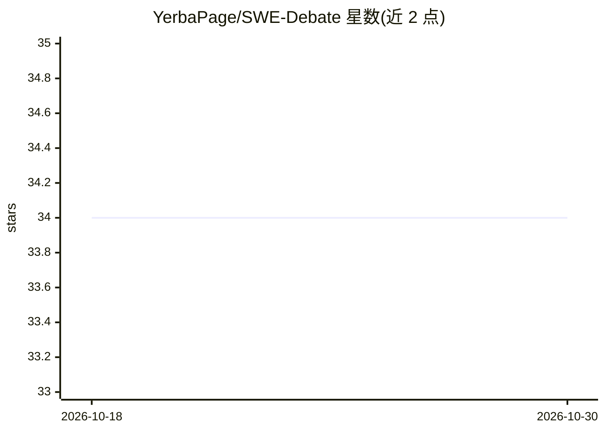

# YerbaPage/SWE-Debate

⭐ 34 · Python · Apache-2.0 · 推送 2025-11-11 · [GitHub](https://github.com/YerbaPage/SWE-Debate) · 组织维护

**多智能体辩论框架：通过竞争性辩论定位并解决软件 issue**

面向软件 issue 解决的竞争性多智能体辩论研究框架（ICSE 2026 论文项目）。基于 Moatless 框架的实体定位流水线：从 issue 描述中抽取代码实体，基于代码依赖图做图驱动搜索，生成定位链，再由多个专家 Agent 协作辩论并自动生成代码修改指导方案。需 Python 3.12+ 与 OpenAI 格式的 LLM API key，通过 pip 安装依赖并配置 .env 使用，示例中配合 DeepSeek 模型运行。

## 筛选速览

| 维度 | 判定 | 备注 |
|---|---|---|
| AI 角色 | `ai-ecosystem` | LLM/agent 周边工具 |
| 许可风险 | `permissive` | Apache-2.0 |
| 部署形态 | `library` | 以包/库形式分发 |
| 模型依赖 | — | README 未给出锁定关系 |
| 硬件要求 | — | 无带数字的原话,不猜 |
| 安装摩擦 | `low` | 无编译、无系统依赖或容器化 |
| 成熟度 | — | 结构信号不足 |

## 能力要点

- 从 issue 描述自动抽取代码实体（类/方法/函数/变量）
- 基于代码依赖图的图驱动搜索与定位链生成
- 多专家 Agent 协作辩论生成代码修改方案
- 基于 Moatless 框架的实体定位流水线，支持 MCTS 流程

## 适用场景

- 研究多智能体辩论在软件缺陷定位与修复中的应用
- 自动从 issue 描述定位代码中的问题实体
- 在 SWE-bench 类任务上复现论文方法

## 场景标签

`多智能体` · 领域:Agent 开发

## 证据(README 行号)

> L3: # SWE-Debate: Competitive Multi-Agent Debate for Software Issue Resolution
> L5: SWE-Debate, a competitive multi-agent debate framework that promotes diverse reasoning paths and achieves more conso
> L9: This project integrates an advanced **Entity Localization Pipeline** based on the Moatless framework, achieving the 

## 星数曲线

2026-10-18 34 → 2026-10-30 34（+0）

---
*卡片 v1 · prompt 1.4 · 生成 2026-10-25 · 置信度 high · 依据 README sha `0ac48b9e7836` · [字段定义](../../DATASET.md)*
