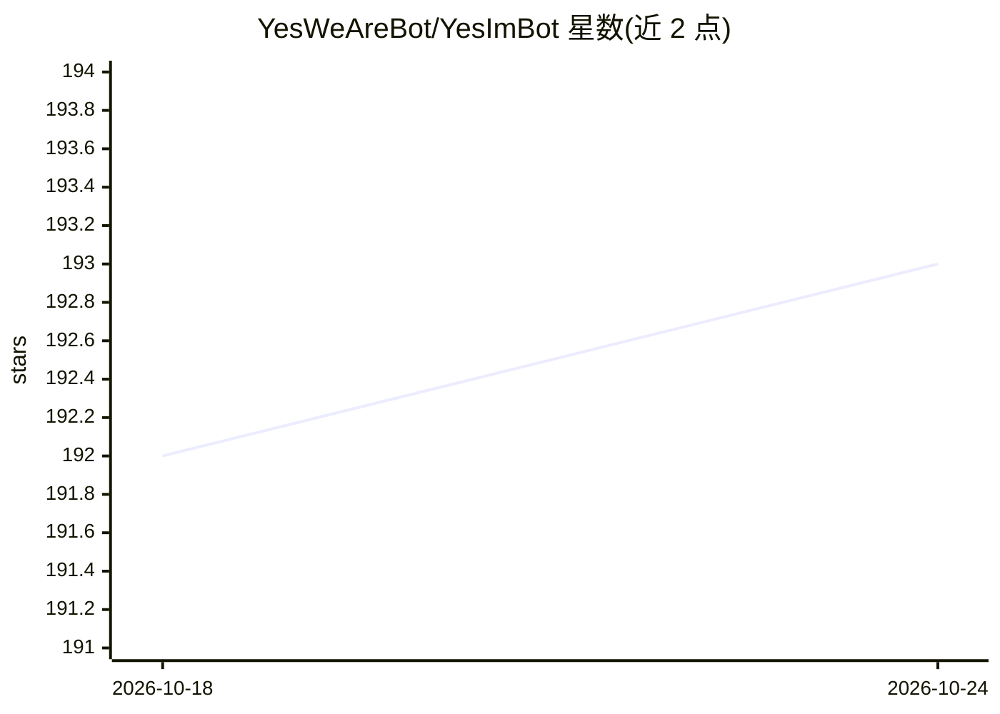

# YesWeAreBot/YesImBot

⭐ 193 · TypeScript · MIT · 推送 2026-10-24 · [GitHub](https://github.com/YesWeAreBot/YesImBot) · [官网](https://docs.yesimbot.chat) · 组织维护 · 中文 README

**基于 Koishi 的群聊 AI 插件与运行时，让 LLM 融入群聊**

作为 Koishi 插件运行的群聊 AI 系统（Athena runtime）：将“观察”与“发言”分离，普通消息进入频道历史，由 Will 机制决定等待或触发模型回合，忙时事件并入当前 turn。通过 provider 插件接入 OpenAI、Anthropic、DeepSeek、Google 等模型，用 models.json 管理模型注册与图片输入能力。能力插件涵盖虚拟文件系统与 Bash 沙箱、MCP 客户端、Web 搜索、MemOS 长期记忆、贴纸处理等。面向使用 Koishi 框架的群聊机器人运营者。

## 筛选速览

| 维度 | 判定 | 备注 |
|---|---|---|
| AI 角色 | `ai-native` | 本体是模型或模型工具 |
| 许可风险 | `permissive` | MIT |
| 部署形态 | `library` | 以包/库形式分发 |
| 模型依赖 | locked-api |  |
| 硬件要求 | — | 无带数字的原话,不猜 |
| 安装摩擦 | `low` | 无编译、无系统依赖或容器化 |
| 成熟度 | — | 结构信号不足 |

## 能力要点

- 消息优先运行时：观察与发言分离，Will 决定模型回合触发
- OpenAI/Anthropic/DeepSeek/Google 多模型 provider 插件接入
- MCP 客户端、Web 搜索、MemOS 记忆、Bash 沙箱等能力插件
- 频道级存储：channel.json、JSONL、assets 与插件数据

## 适用场景

- 在 QQ/Telegram 等平台群聊中部署接入 LLM 的对话机器人
- 为群聊 AI 配置工具调用、搜索与长期记忆能力
- 基于 Koishi 生态扩展自有的聊天 agent 功能

## 场景标签

`聊天机器人` · 领域:对话与助手

## 证据(README 行号)

> L15: **YesImBot** 是一套基于 Koishi 的群聊 AI 插件与运行时，让大语言模型以自然的方式融入你的群聊。
> L20: - **多模型即插即用** — 通过 provider 插件接入 OpenAI、Anthropic、DeepSeek、Google 等模型，并通过 `models.json` 管理模型注册与默认值。

## 星数曲线

2026-10-18 192 → 2026-10-24 193（+1）

---
*卡片 v1 · prompt 1.4 · 生成 2026-10-22 · 置信度 high · 依据 README sha `5bc42e0d4c93` · [字段定义](../../DATASET.md)*
