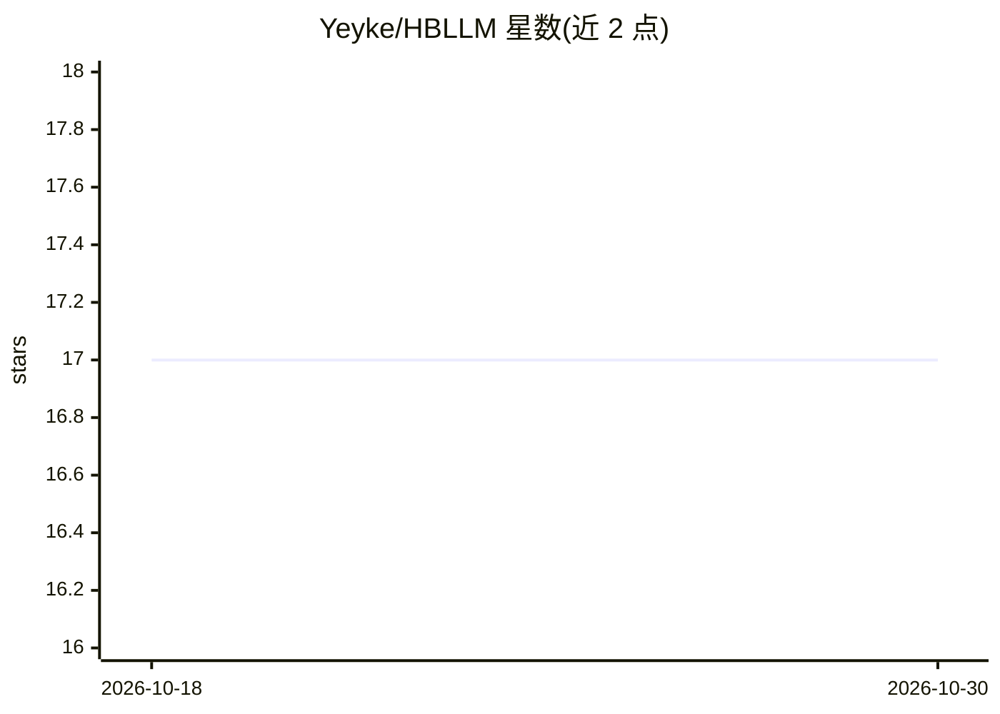

# Yeyke/HBLLM

⭐ 17 · Python · GPL-3.0 · 推送 2025-12-17 · [GitHub](https://github.com/Yeyke/HBLLM) · [官网](https://arxiv.org/abs/2512.00862) · 个人维护

**面向 LLM 的小波增强 1-bit 后训练量化方法（NeurIPS 2025）**

NeurIPS 2025 (spotlight) 论文 HBLLM 的官方代码：利用 Haar 小波变换做频率分解以增强表达能力，包含频率感知的行内多参数分组与基于 ℓ2 范数的显著性列选择两种结构感知分组策略，非显著权重在各频段量化组间共享均值以优化存储。实验在 OPT 与 LLaMA 系列模型上运行，LLaMA2-13B 达到 6.71 困惑度、平均每权重 1.08 bit 存储。以 Python 脚本形式提供，依赖 torch/transformers/datasets，实验在 80GB A100 上完成，70B 以下模型可在 24GB 3090 Ti 上运行。

## 筛选速览

| 维度 | 判定 | 备注 |
|---|---|---|
| AI 角色 | `ai-ecosystem` | LLM/agent 周边工具 |
| 许可风险 | `viral` | GPL-3.0 |
| 部署形态 | `None` |  |
| 模型依赖 | — | README 未给出锁定关系 |
| 硬件要求 | — | 无带数字的原话,不猜 |
| 安装摩擦 | `medium` | 含编译或系统依赖之一 |
| 成熟度 | — | 结构信号不足 |

## 能力要点

- Haar 小波变换增强的 1-bit 后训练量化（行/列两种变换模式）
- 频率感知行内分组 + ℓ2 范数显著性列选择
- 共享均值策略优化各频段存储效率
- 支持 OPT 与 LLaMA 系列模型二值化，单卡可运行

## 适用场景

- 研究者复现论文中的 1-bit 量化实验
- 对 OPT/LLaMA 模型做二值化压缩以降低存储
- 比较小波增强量化与 GPTQ/BiLLM 等方法的实现细节

## 场景标签

`模型量化` · 领域:训练与推理

## 证据(README 行号)

> L4: We introduce HBLLM, a wavelet-enhanced high-fidelity $1$-bit post-training quantization method for Large Language Mo
> L20: python3 run.py opt-1.3b /home/models/opt-1.3b c4 row-hbraq --blocksize 128 --salient_metric l2 --group_partition ro

## 星数曲线

2026-10-18 17 → 2026-10-30 17（+0）

---
*卡片 v1 · prompt 1.4 · 生成 2026-10-29 · 置信度 high · 依据 README sha `fe2ec0101c73` · [字段定义](../../DATASET.md)*
