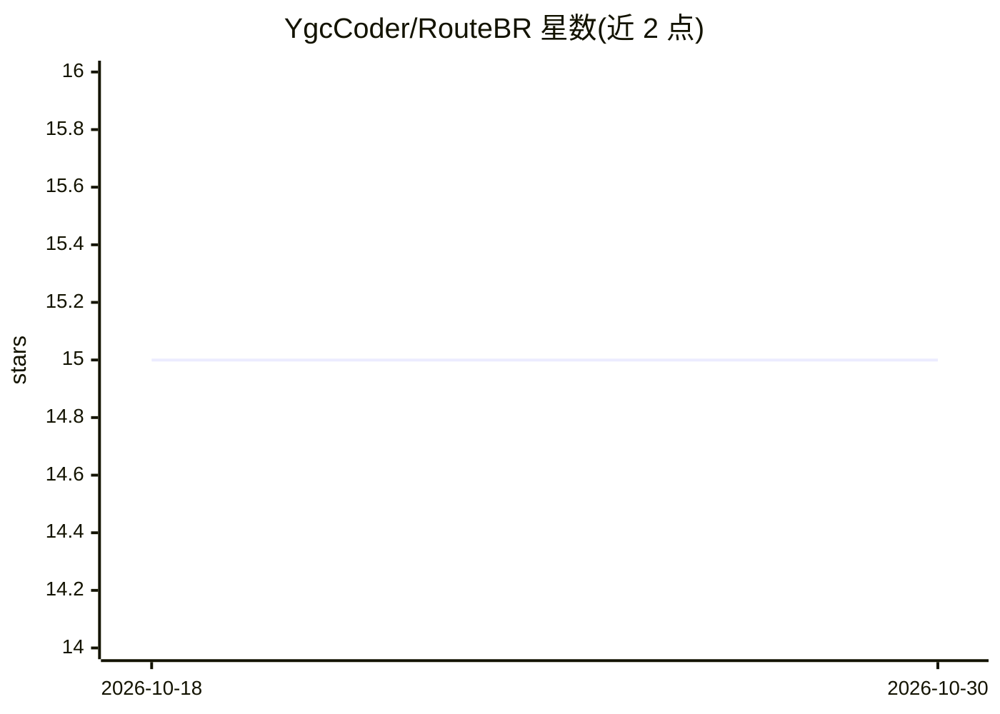

# YgcCoder/RouteBR

⭐ 15 · Python · MIT · 推送 2026-10-13 · [GitHub](https://github.com/YgcCoder/RouteBR) · 个人维护

**面向客服软件的故障关闭式 LLM 响应前路由参考实现与基准**

RouteBR 是故障关闭式（fail-closed）LLM 响应前路由的参考实现与可复现工件：一次模型调用提议主行动与闭集对象，确定性代码完成行动提交、评估版本化运行时规则、校验对象契约，输出类型化派发或有界终止，低序候选仅作审计。含 600 个隐私保护合成场景（由某金融机构常见保密请求模式重建）、960 次 SELECT 后端筛选与 1,000 次确认矩阵执行的归一化收据。无网络验证命令不调用托管模型，付费重跑需环境变量凭据且不保证精确再生。面向做 LLM 客服系统可靠性与评测的研究/工程读者。

## 筛选速览

| 维度 | 判定 | 备注 |
|---|---|---|
| AI 角色 | `ai-ecosystem` | LLM/agent 周边工具 |
| 许可风险 | `permissive` | MIT |
| 部署形态 | `library` | 以包/库形式分发 |
| 模型依赖 | — | README 未给出锁定关系 |
| 硬件要求 | — | 无带数字的原话,不猜 |
| 安装摩擦 | `low` | 无编译、无系统依赖或容器化 |
| 成熟度 | — | 结构信号不足 |

## 能力要点

- 确定性控制器提交主行动，闭集对象契约校验，故障关闭输出类型化派发或有界终止
- 600 个隐私保护合成场景与冻结 SELECT/CONFIRM 子集
- 1,960 次系统-案例执行的归一化逐案收据，可离线重建与完整性校验
- 托管 API 以无凭据 profile 抽象，密钥不存入仓库

## 适用场景

- 复现论文式实验的基准结果与完整性检查
- 在客服/金融软件中引入响应前路由与运行时强制
- 研究 LLM 输出受确定性规则约束的路由模式

## 场景标签

`模型评测` · 领域:评测与运维

## 证据(README 行号)

> L3: RouteBR is a reference implementation and reproducibility artifact for fail-closed pre-response routing in LLM-enabl
> L10: - `experiments/`: frozen prompts, credential-free API profiles, rerun scripts, and normalized case-level receipts f

## 星数曲线

2026-10-18 15 → 2026-10-30 15（+0）

---
*卡片 v1 · prompt 1.4 · 生成 2026-10-30 · 置信度 high · 依据 README sha `1dccefea64f7` · [字段定义](../../DATASET.md)*
