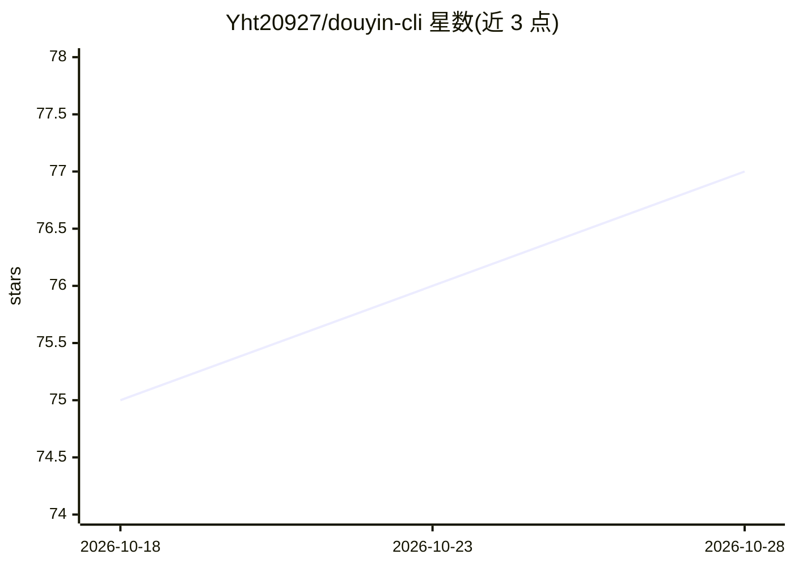

# Yht20927/douyin-cli

⭐ 79 · JavaScript · MIT · 推送 2026-10-10 · [GitHub](https://github.com/Yht20927/douyin-cli) · 个人维护 · 中文 README

**抖音评论运营 CLI：搜索视频、拉取评论、AI 生成并自动发布回复**

基于 Bridge Framework（Node.js CLI + Bridge Server + 油猴脚本）的抖音评论代管工具，面向运营自有账号的用户。功能包括视频搜索、评论与嵌套回复获取、带图评论发布、视频下载、私信与多账号管理。AI 部分为 ReplyEngine 生成引擎：7 种人格轮换、A-F 六类回复策略、上下文隔离，支持 Anthropic 与 OpenAI 兼容双 Provider 并追踪 Token 用量。内置拟人化设计：写操作 40-55s 随机间隔、模拟浏览、请求参数随机化、10 分钟断路器。依赖 Node.js 18+、Chrome + Tampermonkey 与 LLM API key。

## 筛选速览

| 维度 | 判定 | 备注 |
|---|---|---|
| AI 角色 | `ai-native` | 本体是模型或模型工具 |
| 许可风险 | `permissive` | MIT |
| 部署形态 | `library` | 以包/库形式分发 |
| 模型依赖 | — | README 未给出锁定关系 |
| 硬件要求 | — | 无带数字的原话,不猜 |
| 安装摩擦 | `medium` | 含编译或系统依赖之一 |
| 成熟度 | — | 结构信号不足 |

## 能力要点

- ReplyEngine 生成引擎：3 种模式、人格绑定、A-F 六类回复策略
- 7 种人格自动轮换 + AI 特征词黑名单 + 语料去重
- Anthropic 原生与 OpenAI 兼容双 Provider，自动检测 base_url，Token 用量追踪
- SQLite 持久化记忆（schema v8）：语料库、失败模式、草稿、事件流

## 适用场景

- 代管自有抖音账号时批量生成并发布评论回复
- 运营活动中做推广评论的计划、发布与事实校验
- 多账号下统一查看评论数据与运营仪表盘

## 场景标签

`浏览器自动化` · 领域:效率与自动化

## 证据(README 行号)

> L8: > 抖音评论运营 CLI 工具。基于 Bridge Framework（Bridge Server + 油猴脚本），支持视频搜索、评论获取、**AI 人格化回复**、**ReplyEngine 独立生成**、**草稿管理**、运营仪
> L10: 核心亮点：**ReplyEngine 评论生成引擎**（generateComment / generateReply / generateReplies）+ **A-F 六类回复策略** + **Anthropic & Open
> L268: - `lib/llm.js` — LLM 客户端（OpenAI + Anthropic 双 Provider，A-F 策略，Token 追踪）

## 星数曲线

2026-10-18 75 → 2026-10-28 77（+2）

---
*卡片 v1 · prompt 1.4 · 生成 2026-10-24 · 置信度 high · 依据 README sha `8d2cc4566468` · [字段定义](../../DATASET.md)*
