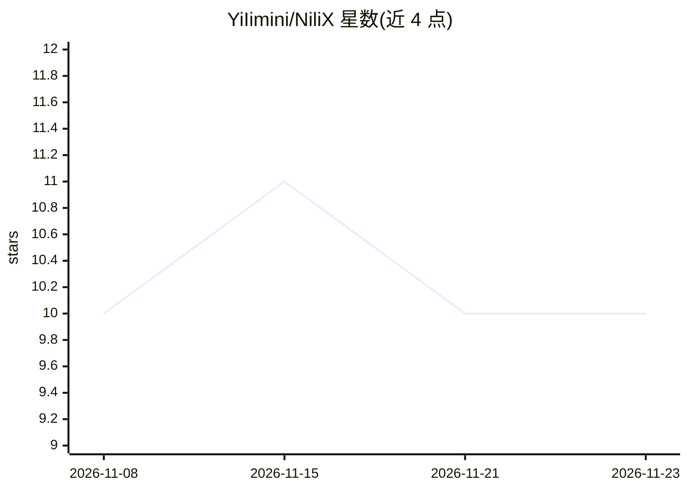

# YiIimini/NiliX

⭐ 10 · Go · 推送 2026-09-08 · [GitHub](https://github.com/YiIimini/NiliX) · 个人维护 · 中文 README

**给创作者的本地 AI 漫剧生产工作台：小说到成片全自动流水线**

Go 单服务实现的本地漫剧生产工具：集成小说管理（书架/阅读器/一键转剧本/AI 续写）与六阶段视频流水线（方案→资产→编码→渲染→质检→合成），通过代管的 ComfyUI 运行 MiniMax H3 R2V 等模型生成逐镜视频并合成成片。内置智能体调度：剧本师复核、审片官 VLM 八维度判分、修复师定点返工。需要 Go 1.22+、ComfyUI、FFmpeg、DeepSeek API Key 与视觉模型。README 标注停止更新，新应用为 ManJuX；许可证为私有项目仅限本机使用。

## 筛选速览

| 维度 | 判定 | 备注 |
|---|---|---|
| AI 角色 | `ai-native` | 本体是模型或模型工具 |
| 许可风险 | `none` | — |
| 部署形态 | `None` |  |
| 模型依赖 | — | README 未给出锁定关系 |
| 硬件要求 | — | 无带数字的原话,不猜 |
| 安装摩擦 | `medium` | 含编译或系统依赖之一 |
| 成熟度 | — | 结构信号不足 |

## 能力要点

- 六阶段流水线支持断点续跑、条件缓存与渲染检查点崩溃恢复
- 智能体审片：审片官 VLM 八维度判分、修复师自动改写提示词返工
- 跨项目角色资产库，形象指纹 sha256 复用免重复渲染
- 自包含 ComfyUI 部署，新电脑一键安装与拷贝迁移

## 适用场景

- 把小说批量转成分镜脚本并生成漫剧成片
- 本地 GPU 上跑通小说到视频的无人值守流水线
- 用审片 Agent 自动质检并返工不合格镜头
- 导出剪映草稿继续剪辑视频与字幕轨

## 场景标签

`视频生成` · 领域:内容生成

## 证据(README 行号)

> L3: 本地 AI 漫剧生产工作台 —— Go 单服务集成：小说管理 + **小说/脚本 → 漫剧全自动流水线**（MiniMax H3 R2V）+ 智能体审片返工 + 系统监测灵动岛。
> L37: |**智能体调度**|🤖 AI 一条龙：剧本师复核 → 审片官逐镜 VLM 判分（八维度对齐 H3 官方能力，判分并发可配）→ 修复师自动改写提示词定点返工 → 终审预算耗尽自动拍板 → 微信升级通知；LLM/VLM token 
> L58: - **ComfyUI**（端口 8190，由本服务代管启停）：MiniMax H3（FL2VA/Ref2VA）、Z-Image、SDXL 等模型 —— 新电脑可在设置「目录与部署」一键安装，或直接拷贝旧机自包含目录

## 星数曲线

2026-11-08 10 → 2026-11-23 10（+0）

---
*卡片 v1 · prompt 1.4 · 生成 2026-11-18 · 置信度 high · 依据 README sha `38f3c7593d3b` · [字段定义](../../DATASET.md)*
