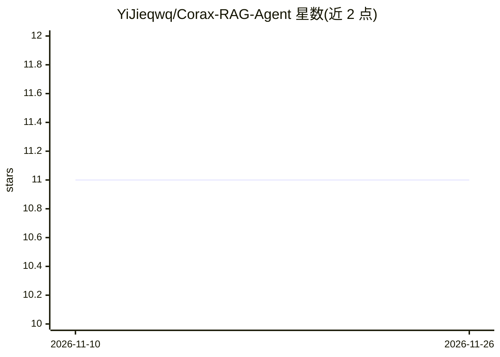

# YiJieqwq/Corax-RAG-Agent

⭐ 11 · Java · MIT · 推送 2026-09-22 · [GitHub](https://github.com/YiJieqwq/Corax-RAG-Agent) · 个人维护 · 中文 README

**QQ 群聊的 Agentic RAG 框架：长期记忆、身份隔离、虚拟文件系统**

以 QFun 插件（BeanShell）形式运行在 QQ 中的轻量 Agentic RAG 框架，为群聊与私聊提供长期记忆、身份隔离与 AI 助手能力。核心机制包括 Corax-Shell 虚拟 Linux 文件系统（能力经 shell 命令暴露）、写操作审批与写保护、自动快照与回滚、热/冷分层记忆、三层可信度评级与三层身份隔离。使用方式为下载 Releases 包解压到 QFun 插件目录，经 /ai 命令配置 API key 并启用；默认接入 DeepSeek 模型，模型、温度、shell 轮数等可经配置表调整。

## 筛选速览

| 维度 | 判定 | 备注 |
|---|---|---|
| AI 角色 | `ai-native` | 本体是模型或模型工具 |
| 许可风险 | `permissive` | MIT |
| 部署形态 | `None` |  |
| 模型依赖 | — | README 未给出锁定关系 |
| 硬件要求 | — | 无带数字的原话,不猜 |
| 安装摩擦 | `low` | 无编译、无系统依赖或容器化 |
| 成熟度 | — | 结构信号不足 |

## 能力要点

- Corax-Shell 虚拟文件系统：管道、重定向、后台任务、网页搜索经 shell 命令暴露
- 写入敏感文件需管理员审批，每次写入自动保存快照可回滚
- Strata 热/冷分层长期记忆与 WARDEN-I 三层身份隔离
- 内置'小猫'等唤醒来词与人设，可 /ai reboot 切换

## 适用场景

- 为 QQ 群聊接入带长期记忆的 AI 助手
- 需要在聊天中隔离不同用户身份与记忆的场景
- 希望通过审批+快照机制约束 AI 写操作的管理

## 场景标签

`聊天机器人` `RAG` `Agent 记忆` · 领域:Agent 开发

## 证据(README 行号)

> L9: Corax-RAG (Corax Strata) is a lightweight Agentic RAG framework running inside QQ. Built as a QFun Plugin (BeanShell
> L22: The AI has a virtual Linux filesystem, and every capability is exposed through `shell(cmd)`:

## 星数曲线

2026-11-10 11 → 2026-11-26 11（+0）

---
*卡片 v1 · prompt 1.4 · 生成 2026-11-18 · 置信度 high · 依据 README sha `648da4edb486` · [字段定义](../../DATASET.md)*
