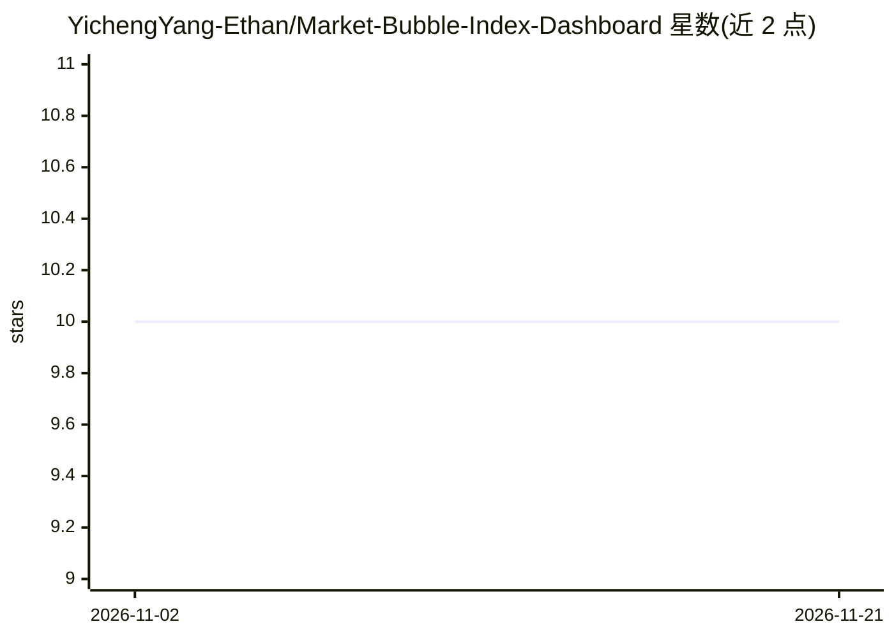

# YichengYang-Ethan/Market-Bubble-Index-Dashboard

⭐ 10 · Python · MIT · 推送 2026-11-20 · [GitHub](https://github.com/YichengYang-Ethan/Market-Bubble-Index-Dashboard) · [官网](https://yichengyang-ethan.github.io/Market-Bubble-Index-Dashboard/) · 个人维护

**给投资者的市场泡沫风险仪表盘：7 指标综合指数与回撤概率**

量化市场泡沫风险的金融仪表盘，三个标签页：泡沫温度（7 指标加权综合为 0–100 分）、崩盘风险（QQQ 未来约 9 个月显著回撤概率，含市场状态检测）、偏离度追踪（QQQ/SPY/TQQQ/IWM 相对均线偏离）。模型经 purged walk-forward CV 验证，v4.1 将各阈值 100% 权重置于 Bayesian Beta-Binomial 层；附两个策略回测。前端 React/TypeScript，数据管线 Python，需 FRED API key，部署于 GitHub Pages。

## 筛选速览

| 维度 | 判定 | 备注 |
|---|---|---|
| AI 角色 | `ai-native` | 本体是模型或模型工具 |
| 许可风险 | `permissive` | MIT |
| 部署形态 | `library` | 以包/库形式分发 |
| 模型依赖 | — | README 未给出锁定关系 |
| 硬件要求 | — | 无带数字的原话,不猜 |
| 安装摩擦 | `low` | 无编译、无系统依赖或容器化 |
| 成熟度 | — | 结构信号不足 |

## 能力要点

- 7 指标（情绪/流动性/估值）加权聚合为 0–100 综合分与五档市场状态
- 混合 3 层回撤概率模型（Lasso、Bayesian Beta-Binomial、EVT/GPD）
- Purged walk-forward CV（180 天 purge）样本外验证，附模型演化研究报告
- 滞后二值与速度信号两个策略的 10+ 年回测

## 适用场景

- 跟踪当前市场泡沫温度与仓位建议区间
- 查看 QQQ 崩盘概率仪表（P>10/20/30/40%）
- 复现数据管线并重新拟合回撤模型

## 场景标签

`金融量化` · 领域:学习与行业

## 证据(README 行号)

> L11: A financial dashboard that quantifies market bubble risk through a **7-indicator composite index** across sentiment
> L47: Hybrid 3-layer model predicting the chance of significant QQQ drawdowns over the next ~9 months:

## 星数曲线

2026-11-02 10 → 2026-11-21 10（+0）

---
*卡片 v1 · prompt 1.4 · 生成 2026-11-20 · 置信度 high · 依据 README sha `c4425eb58847` · [字段定义](../../DATASET.md)*
