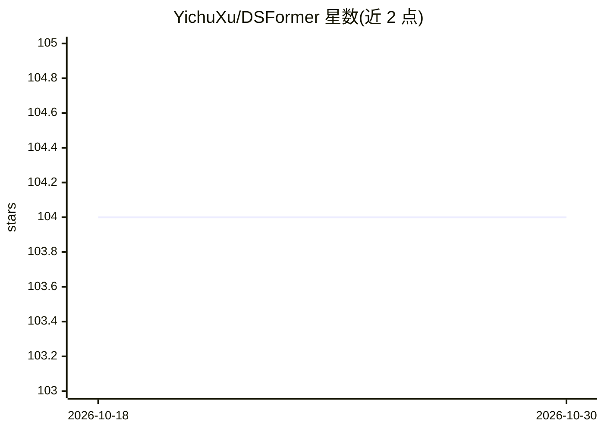

# YichuXu/DSFormer

⭐ 104 · Python · MIT · 推送 2026-03-22 · [GitHub](https://github.com/YichuXu/DSFormer) · [官网](https://www.sciencedirect.com/science/article/pii/S089360802500190X?dgcid=author1) · 组织维护 · 中文 README

**高光谱图像分类的双选择性融合 Transformer 网络（论文代码）**

Neural Networks 2025 论文 DSFormer 的官方 PyTorch 实现：一种用于高光谱图像（HSI）分类的双选择性融合 Transformer 网络，自适应选择并融合来自不同感受野的特征，进行空间-光谱联合上下文建模。由武汉大学团队维护。安装方式为 git clone 源码、conda 建环境后 pip 安装 requirements.txt（Python 3.8、PyTorch 1.13），数据集从 Google Drive 或百度网盘下载，通过 python main.py 训练与评估，支持 PU/IP/Houston13/WHU-HH 等数据集。

## 筛选速览

| 维度 | 判定 | 备注 |
|---|---|---|
| AI 角色 | `ai-native` | 本体是模型或模型工具 |
| 许可风险 | `permissive` | MIT |
| 部署形态 | `library` | 以包/库形式分发 |
| 模型依赖 | — | README 未给出锁定关系 |
| 硬件要求 | — | 无带数字的原话,不猜 |
| 安装摩擦 | `low` | 无编译、无系统依赖或容器化 |
| 成熟度 | — | 结构信号不足 |

## 能力要点

- 双选择性融合 Transformer 用于 HSI 分类
- 自适应选择与融合多感受野特征，空间-光谱联合建模
- 提供 PU/IP/Houston13/WHU-HH 数据集的训练评估命令

## 适用场景

- 复现论文中的高光谱图像分类实验
- 在高光谱遥感数据集上训练与评估分类模型
- 作为 Transformer 遥感分类研究的代码基础

## 场景标签

`目标检测` · 领域:感知与多模态

## 证据(README 行号)

> L3:  Dual Selective Fusion Transformer Network for Hyperspectral Image Classification
> L19: * **DSFormer** is a novel Dual Selective Fusion
> L65: python main.py --model DSFormer --dataset_name pu --num_run 10 --epoch 500 --device 0 --dataID 1 --patch_size 10 --

## 星数曲线

2026-10-18 104 → 2026-10-30 104（+0）

---
*卡片 v1 · prompt 1.4 · 生成 2026-10-23 · 置信度 mid · 依据 README sha `69880bce7e1a` · [字段定义](../../DATASET.md)*
