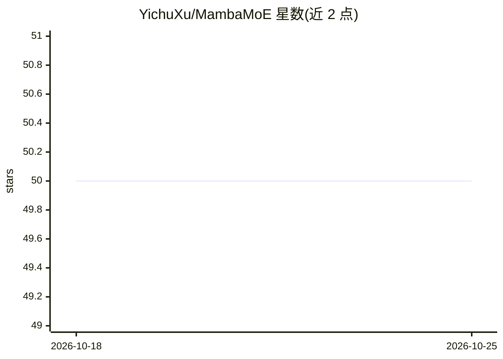

# YichuXu/MambaMoE

⭐ 50 · Python · MIT · 推送 2026-03-21 · [GitHub](https://github.com/YichuXu/MambaMoE) · [官网](https://www.sciencedirect.com/science/article/abs/pii/S1566253525008735) · 组织维护 · 中文 README

**高光谱图像分类的 Mamba 混合专家深度模型（论文代码）**

武汉大学团队发表于 Information Fusion 2025 的论文官方实现：基于 Mamba 状态空间模型的光谱-空间混合专家（MoE）框架，用于高光谱图像（HSI）分类，作者称其为 HSI 分类领域首个 MoE 深度网络。提供训练样本生成、训练与评估的 Python 脚本（PyTorch 1.13、mamba_ssm 1.2.0），数据集从 Google Drive 或百度网盘下载。面向科研复现与遥感地物分类研究，训练命令通过 CUDA_VISIBLE_DEVICES 指定 GPU，依赖 selective_scan 内核编译安装。

## 筛选速览

| 维度 | 判定 | 备注 |
|---|---|---|
| AI 角色 | `ai-native` | 本体是模型或模型工具 |
| 许可风险 | `permissive` | MIT |
| 部署形态 | `library` | 以包/库形式分发 |
| 模型依赖 | — | README 未给出锁定关系 |
| 硬件要求 | — | 无带数字的原话,不猜 |
| 安装摩擦 | `low` | 无编译、无系统依赖或容器化 |
| 成熟度 | — | 结构信号不足 |

## 能力要点

- 基于 Mamba 的光谱-空间混合专家（MoE）框架
- 提供 HSI 分类训练与评估完整脚本（GenSample.py / main.py）
- 支持 PU、Houston13、WHU-HC 等多个数据集配置
- 结果可视化文件在 results 文件夹提供

## 适用场景

- 复现论文中的高光谱图像分类实验
- 在自有多光谱/高光谱数据集上训练 MambaMoE 模型
- 研究 Mamba 与混合专家结构在遥感分类中的应用

## 场景标签

`科研工具` `目标检测` · 领域:学习与行业

## 证据(README 行号)

> L11: * **MambaMoE** is a novel Mamba-based
> L12: spectral-spatial mixture-of-experts framework for HSI
> L13: classification. To the best of our knowledge, this is the

## 星数曲线

2026-10-18 50 → 2026-10-25 50（+0）

---
*卡片 v1 · prompt 1.4 · 生成 2026-10-24 · 置信度 high · 依据 README sha `84590dddc265` · [字段定义](../../DATASET.md)*
