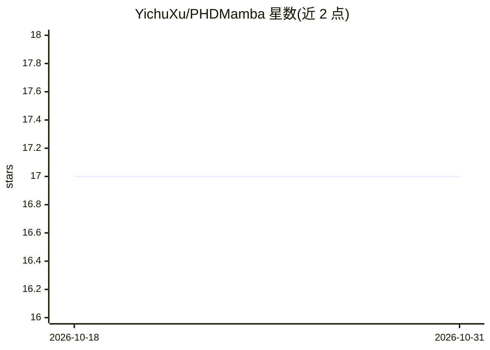

# YichuXu/PHDMamba

⭐ 17 · Python · MIT · 推送 2026-01-18 · [GitHub](https://github.com/YichuXu/PHDMamba) · [官网](https://ieeexplore.ieee.org/document/11222630) · 组织维护 · 中文 README

**IEEE GRSL 2025 论文官方代码：高光谱图像分类的混合 Mamba 模型**

PHDMamba 论文（IEEE Geoscience and Remote Sensing Letters 2025）的 PyTorch 官方实现：提出渐进式混合 Mamba 模块，沿光谱与空间维度分阶段建模长程依赖，并引入光谱-空间交互模块融合上下文特征。面向高光谱图像（HSI）分类的科研复现场景：git clone 源码后以 conda + pip 搭建环境（Python 3.8、PyTorch 1.13、mamba_ssm==1.2.0），从 Google Drive 或百度网盘下载数据集，运行 GenSample.py 生成训练样本并用 main.py 训练评估，README 给出 PU/Houston13/WHU-Hi 三组数据集的示例命令。

## 筛选速览

| 维度 | 判定 | 备注 |
|---|---|---|
| AI 角色 | `ai-native` | 本体是模型或模型工具 |
| 许可风险 | `permissive` | MIT |
| 部署形态 | `library` | 以包/库形式分发 |
| 模型依赖 | — | README 未给出锁定关系 |
| 硬件要求 | — | 无带数字的原话,不猜 |
| 安装摩擦 | `low` | 无编译、无系统依赖或容器化 |
| 成熟度 | — | 结构信号不足 |

## 能力要点

- 渐进式混合 Mamba 模块：光谱与空间维度分阶段长程建模
- 光谱-空间交互模块自适应融合上下文特征
- 提供 PU/Houston13/WHU-Hi 数据集的训练评估示例命令
- results 文件夹提供可视化结果

## 适用场景

- 复现论文中的高光谱图像分类实验
- 在自有高光谱数据集上训练 Mamba 架构分类模型
- 作为 Mamba 遥感分类方法的代码参考

## 场景标签

`目标检测` · 领域:感知与多模态

## 证据(README 行号)

> L12: * **PHDMamba** is a Progressive Hybrid Mamba Module, which performs
> L66: - The following commands show how to train and evaluate PHDMamba for HSI classification:

## 星数曲线

2026-10-18 17 → 2026-10-31 17（+0）

---
*卡片 v1 · prompt 1.4 · 生成 2026-10-30 · 置信度 mid · 依据 README sha `98b5faea7f65` · [字段定义](../../DATASET.md)*
