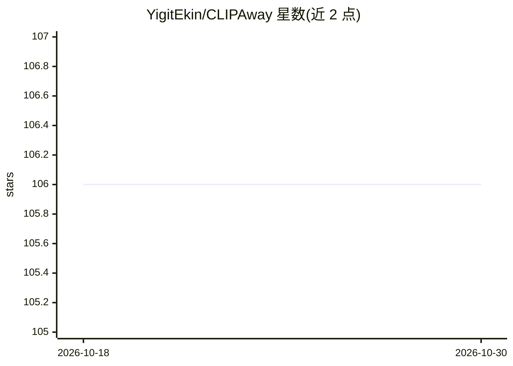

# YigitEkin/CLIPAway

⭐ 106 · Python · MIT · 推送 2026-03-19 · [GitHub](https://github.com/YigitEkin/CLIPAway) · [官网](https://yigitekin.github.io/CLIPAway/) · 个人维护

**NeurIPS 2024 论文官方实现：扩散模型图像物体擦除**

CLIPAway 论文（NeurIPS 2024）的官方 PyTorch 实现：通过投影操纵 CLIP 嵌入，聚焦背景区域并排除前景元素，利用 Stable Diffusion 先验实现无缝物体擦除，即插即用、兼容多种扩散 inpainting 技术。仓库提供训练与推理代码：训练 MLP 投影网络（基于 COCO 2017），推理需先膨胀掩码（提供 dilate.py 脚本）再运行 inference.py，另含 Gradio 网页界面。运行依赖 Alpha-CLIP、IP-Adapter 预训练模型，conda 环境安装。

## 筛选速览

| 维度 | 判定 | 备注 |
|---|---|---|
| AI 角色 | `ai-native` | 本体是模型或模型工具 |
| 许可风险 | `permissive` | MIT |
| 部署形态 | `None` |  |
| 模型依赖 | — | README 未给出锁定关系 |
| 硬件要求 | — | 无带数字的原话,不猜 |
| 安装摩擦 | `medium` | 含编译或系统依赖之一 |
| 成熟度 | — | 结构信号不足 |

## 能力要点

- CLIP 嵌入投影聚焦背景、排除前景，实现物体擦除
- 即插即用，兼容多种扩散 inpainting 技术，无需专门训练数据或人工标注
- 提供训练、推理、掩码膨胀脚本与 Gradio 界面

## 适用场景

- 我想从照片中擦除不需要的物体并补全背景
- 复现论文或在自定义数据上训练 MLP 投影网络
- 通过 Gradio 界面交互式测试物体擦除效果

## 场景标签

`图像生成` `图像视频处理` · 领域:内容生成

## 证据(README 行号)

> L4: This repository contains the official implementation of the paper CLIPAway which is accepted to NeurIPS 2024. CLIPAw
> L13: > Advanced image editing techniques, particularly inpainting, are essential for seamlessly removing unwanted elemen

## 星数曲线

2026-10-18 106 → 2026-10-30 106（+0）

---
*卡片 v1 · prompt 1.4 · 生成 2026-10-23 · 置信度 high · 依据 README sha `32b62178c069` · [字段定义](../../DATASET.md)*
