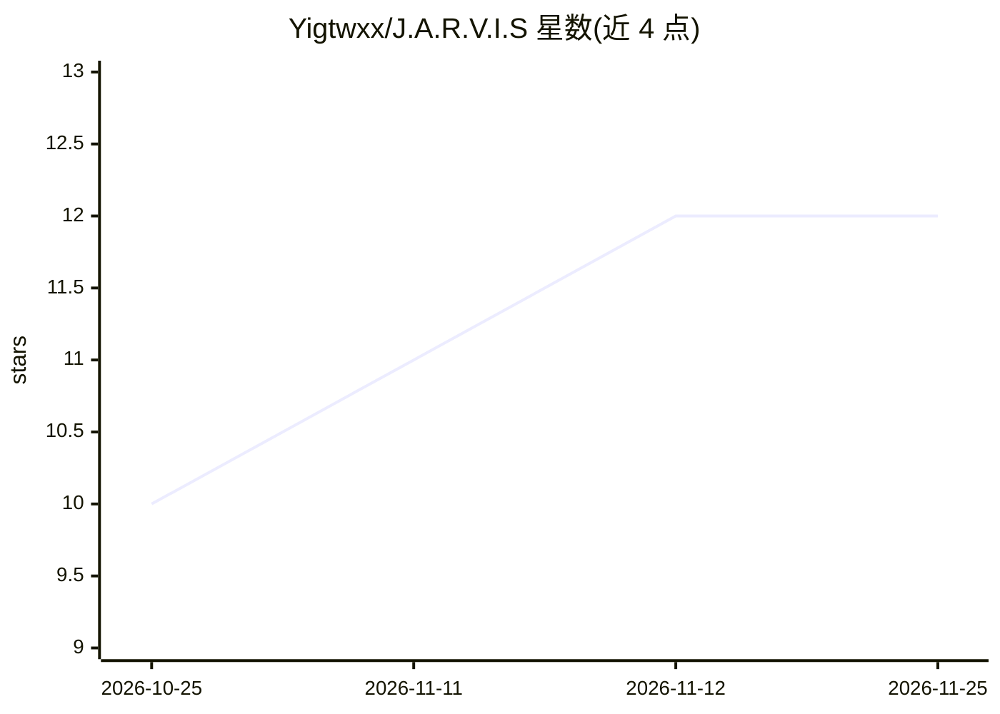

# Yigtwxx/J.A.R.V.I.S

⭐ 12 · Python · MIT · 推送 2026-10-19 · [GitHub](https://github.com/Yigtwxx/J.A.R.V.I.S) · 个人维护

**本地运行的 OSINT 情报平台：抓取网络信息生成人物情报档案**

模块化全栈 OSINT 平台，前后端分离（FastAPI + Next.js）。输入人名后按深度配置（1-10 档）执行五阶段流水线：GitHub 索引、15+ 社交平台档案发现、网页深度抓取、本地 LLM 综合分析，输出含心理画像、影响网络图、行为预测的结构化档案。所有 AI 分析通过 Ollama 本地运行（文本模型 + 视觉模型），数据存于本地 SQLite/PostgreSQL。另含 Agent 对话模式、DeepFace 人脸比对、目标定时监控与 PDF/JSON 导出。

## 筛选速览

| 维度 | 判定 | 备注 |
|---|---|---|
| AI 角色 | `ai-native` | 本体是模型或模型工具 |
| 许可风险 | `permissive` | MIT |
| 部署形态 | `self-host` | docker 或自建部署 |
| 模型依赖 | local-ok | 支持本地模型 |
| 硬件要求 | `gpu-8g` | |
| 安装摩擦 | `low` | 无编译、无系统依赖或容器化 |
| 成熟度 | — | 结构信号不足 |

## 能力要点

- 五阶段 OSINT 流水线，15+ 社交平台经搜索引擎代理抓取
- 全部 AI 分析经 Ollama 本地运行，数据不出本地网络
- DeepFace 跨平台人脸比对与 llama3.2-vision 图像分析
- Agent 模式自主决策调用 OSINT 工具，支持目标定时监控

## 适用场景

- 输入人名自动汇总跨平台公开信息生成情报档案
- 对社交媒体照片做本地视觉分析与 OCR
- 对关注目标设置定时监控并检测变更

## 场景标签

`网页抓取` `OCR` · 领域:效率与自动化

## 证据(README 行号)

> L22: J.A.R.V.I.S is a modular, full-stack Open Source Intelligence (OSINT) and AI assistant platform. It goes beyond sim
> L148: ### Stage 4: Local AI Synthesis (`ai_service.py`)
> L150: All formatted data from Stages 1–3 is compacted into a single prompt and sent to the local Ollama instance (`qwen3

## 星数曲线

2026-10-25 10 → 2026-11-25 12（+2）

---
*卡片 v1 · prompt 1.4 · 生成 2026-11-18 · 置信度 high · 依据 README sha `108b7d85c3ba` · [字段定义](../../DATASET.md)*
