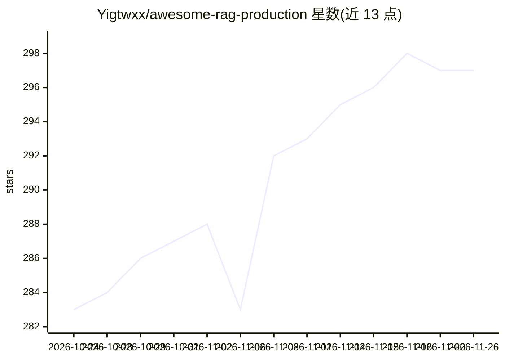

# Yigtwxx/awesome-rag-production

⭐ 297 · Python · CC0-1.0 · 推送 2026-11-14 · [GitHub](https://github.com/Yigtwxx/awesome-rag-production) · [官网](https://yigtwxx.github.io/awesome-rag-production/) · 个人维护

**面向工程团队的生产级 RAG 工具与最佳实践清单**

一份面向生产环境的 RAG 资源策展清单，按框架、向量数据库、嵌入模型、数据解析、评测与可观测性等环节组织条目。每条 benchmark 数字带来源标签（第三方/厂商/作者），配套决策树、三套参考架构（本地/中规模/企业级）及 LinkedIn、DoorDash 案例研究，每周通过 discovery_engine 做新鲜度审计，另提供可搜索的网站版本。受众为搭建可扩展 RAG 系统的工程团队。

## 筛选速览

| 维度 | 判定 | 备注 |
|---|---|---|
| AI 角色 | `ai-knowledge` | 知识聚合/清单类 |
| 许可风险 | `viral` | CC0-1.0 |
| 部署形态 | `None` |  |
| 模型依赖 | local-ok | 支持本地模型 |
| 硬件要求 | — | 无带数字的原话,不猜 |
| 安装摩擦 | `low` | 无编译、无系统依赖或容器化 |
| 成熟度 | — | 结构信号不足 |

## 能力要点

- 每条目生产用途筛选，benchmark 数字带来源标签或移除
- 决策树与三套参考架构（本地/中规模/企业级）
- 每周新鲜度审计并标注条目维护状态（如 R2R、OmniParse）
- LinkedIn/DoorDash 真实生产案例研究

## 适用场景

- 为生产 RAG 系统选型框架、向量库、reranker
- 参考架构规划从原型到企业级的技术栈演进
- 了解大规模向量检索在生产中的常见模式

## 场景标签

`RAG` `精选清单` · 领域:知识与检索

## 证据(README 行号)

> L3: > A curated collection of battle-tested tools, frameworks, and best practices for building, scaling, and monitoring 
> L26: **Not a link dump.** Every entry is selected for production use, and every
> L42: ## Contents

## 星数曲线

2026-10-24 283 → 2026-11-26 297（+14）

---
*卡片 v1 · prompt 1.4 · 生成 2026-11-25 · 置信度 high · 依据 README sha `d6c4e824a94b` · [字段定义](../../DATASET.md)*
