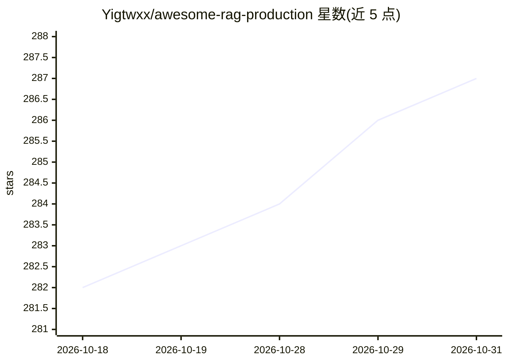

# Yigtwxx/awesome-rag-production

⭐ 287 · Python · CC0-1.0 · 推送 2026-10-26 · [GitHub](https://github.com/Yigtwxx/awesome-rag-production) · [官网](https://yigtwxx.github.io/awesome-rag-production/) · 个人维护

**生产级 RAG 工具与实践策展清单，面向 RAG 系统建设者**

策展型 awesome 清单：收录构建、扩展与监控生产级 RAG 系统的工具、框架与最佳实践，条目按框架编排、数据摄取与解析等类别组织。提供选型决策指南（含 Mermaid 决策树）、三套参考架构（本地/中等规模/企业级）以及 LinkedIn、DoorDash、Discord 的实际案例。基准数字按来源标注（第三方/厂商/作者）或移除，并声称每周做新鲜度审计。许可为 CC0-1.0。

## 筛选速览

| 维度 | 判定 | 备注 |
|---|---|---|
| AI 角色 | `ai-knowledge` | 知识聚合/清单类 |
| 许可风险 | `viral` | CC0-1.0 |
| 部署形态 | `None` |  |
| 模型依赖 | — | README 未给出锁定关系 |
| 硬件要求 | — | 无带数字的原话,不猜 |
| 安装摩擦 | `low` | 无编译、无系统依赖或容器化 |
| 成熟度 | — | 结构信号不足 |

## 能力要点

- 三套分阶段参考架构（本地 Ollama+Chroma → 企业级 Milvus+vLLM）
- 框架对比表覆盖 LlamaIndex/LangChain/LangGraph/Haystack 等维度
- 基准数字按来源标签（[3P]/[V]/[A]）标注
- 收录 LinkedIn/DoorDash/Discord 生产案例与共性模式

## 适用场景

- 搭建 RAG 系统前按规模选型框架与向量库
- 了解各成熟度阶段的技术栈组合与风险
- 查阅生产环境 RAG 的真实案例经验

## 场景标签

`RAG` `精选清单` · 领域:知识与检索

## 证据(README 行号)

> L3: > A curated collection of battle-tested tools, frameworks, and best practices for building, scaling, and monitoring 
> L22: **Not a link dump.** Every entry is selected for production use, and every

## 星数曲线

2026-10-18 282 → 2026-10-31 287（+5）

---
*卡片 v1 · prompt 1.4 · 生成 2026-10-22 · 置信度 high · 依据 README sha `31d7d239c735` · [字段定义](../../DATASET.md)*
