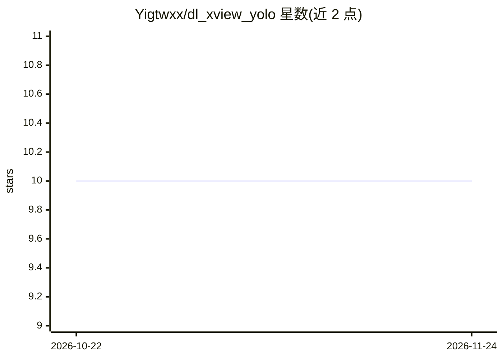

# Yigtwxx/dl_xview_yolo

⭐ 10 · Python · MIT · 推送 2026-11-05 · [GitHub](https://github.com/Yigtwxx/dl_xview_yolo) · 个人维护

**卫星遥感图像的目标检测训练与推理工具包**

基于 Ultralytics YOLOv8 的卫星/航拍图像目标检测项目，提供 xView 与 DOTA 数据集到 YOLO 格式的转换脚本（DOTA 有向框转水平框、16 位 GeoTIFF 归一化为 8 位 JPEG）、训练/验证/指标绘图脚本，以及由 FastAPI 提供的网页拖拽预测界面。检测类别合并 xView 60 类与 DOTA 15 类共 75 类，验证划分用文件名 md5 哈希保证可复现。要求 Python ≥3.10、PyTorch ≥2.0；权重不随 Git 分发。

## 筛选速览

| 维度 | 判定 | 备注 |
|---|---|---|
| AI 角色 | `ai-native` | 本体是模型或模型工具 |
| 许可风险 | `permissive` | MIT |
| 部署形态 | `None` |  |
| 模型依赖 | — | README 未给出锁定关系 |
| 硬件要求 | — | 无带数字的原话,不猜 |
| 安装摩擦 | `medium` | 含编译或系统依赖之一 |
| 成熟度 | — | 结构信号不足 |

## 能力要点

- xView 与 DOTA 合并转换，75 类共享同一 labels 目录
- DOTA 8 点有向框转轴对齐 YOLO 框，GeoTIFF 归一化
- FastAPI 网页预测界面，拖拽返回标注图像
- 设备自动选择 CUDA → MPS → CPU

## 适用场景

- 在卫星/航拍图像上训练 YOLOv8 检测飞机、舰船、车辆、桥梁
- 将 xView/DOTA 原始标注批量转为 YOLO 格式
- 通过网页界面上传图像并查看检测标注结果

## 场景标签

`目标检测` · 领域:感知与多模态

## 证据(README 行号)

> L10: **Deep Learning–based Object Detection** system for satellite imagery using **YOLOv8**.
> L19: - Object detection using YOLOv8 (Ultralytics)
> L23: - Device selection follows CUDA → MPS → CPU, so it runs on NVIDIA, Apple Silicon and CPU

## 星数曲线

2026-10-22 10 → 2026-11-24 10（+0）

---
*卡片 v1 · prompt 1.4 · 生成 2026-11-20 · 置信度 high · 依据 README sha `d9025b9c90e6` · [字段定义](../../DATASET.md)*
