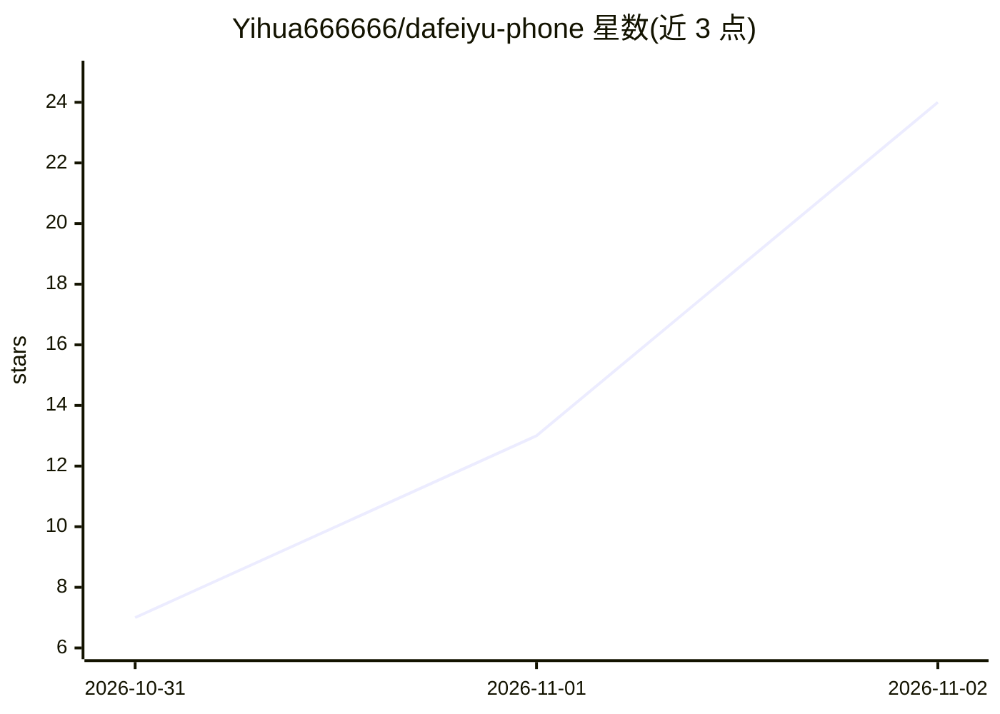

# Yihua666666/dafeiyu-phone

⭐ 24 · JavaScript · MIT · 推送 2026-11-01 · [GitHub](https://github.com/Yihua666666/dafeiyu-phone) · [官网](https://github.com/Yihua666666/dafeiyu-phone/releases/tag/v1.0.0) · 个人维护 · 中文 README

**跑在闲置安卓手机上的自主陪伴鲸鱼娘 Agent**

用 AutoX.js 控制 Android 手机（无障碍+悬浮窗），接 DeepSeek API 做人设、决策与聊天，通过 ntfy 实现远程消息，并以原生 APK 作为聊天窗口。她每 10-20 分钟自主决定行为（写日记、看天气、刷视频），支持关屏唤醒、开机自启、主动发消息；记忆为本地文件系统（facts.md/self.md/每日日记与回顾），无需外部记忆库。需 Android 8+ 手机、DeepSeek API Key；不 root、不使用 SIM 卡与支付，消息非端到端加密。

## 筛选速览

| 维度 | 判定 | 备注 |
|---|---|---|
| AI 角色 | `ai-native` | 本体是模型或模型工具 |
| 许可风险 | `permissive` | MIT |
| 部署形态 | `None` |  |
| 模型依赖 | locked-api |  |
| 硬件要求 | — | 无带数字的原话,不猜 |
| 安装摩擦 | `medium` | 含编译或系统依赖之一 |
| 成熟度 | — | 结构信号不足 |

## 能力要点

- AutoX.js 控制手机 + DeepSeek API 决策聊天 + ntfy 远程消息通道
- 本地文件长期记忆（facts/self/日记/每日回顾），全程不联网存记忆
- 自主作息：10-20 分钟自主决策、关屏唤醒、开机自启、90 分钟空闲主动找主人
- 93 张立绘画廊与本地 PaddleOCR 看图（屏幕/相册/网络图不出本地）

## 适用场景

- 把闲置安卓手机变成一个会自己生活、可远程聊天的陪伴角色
- 通过 ntfy/App 远程下指令让她操作手机（如查空间、刷视频）
- 用'记住：'指令让她积累关于主人的长期记忆

## 场景标签

`AI 助手` `聊天机器人` `GUI 自动化` · 领域:效率与自动化

## 证据(README 行号)

> L5: 这是一个**完全跑在手机里**的陪伴 Agent：
> L8: - 用 DeepSeek API 做人设、决策和聊天
> L27: - **自己生活**：每 10–20 分钟自己想想做什么，写日记、翻笔记、看天气、刷视频、看番

## 星数曲线

2026-10-31 7 → 2026-11-02 24（+17）

---
*卡片 v1 · prompt 1.4 · 生成 2026-11-01 · 置信度 high · 依据 README sha `645f9015ff2e` · [字段定义](../../DATASET.md)*
