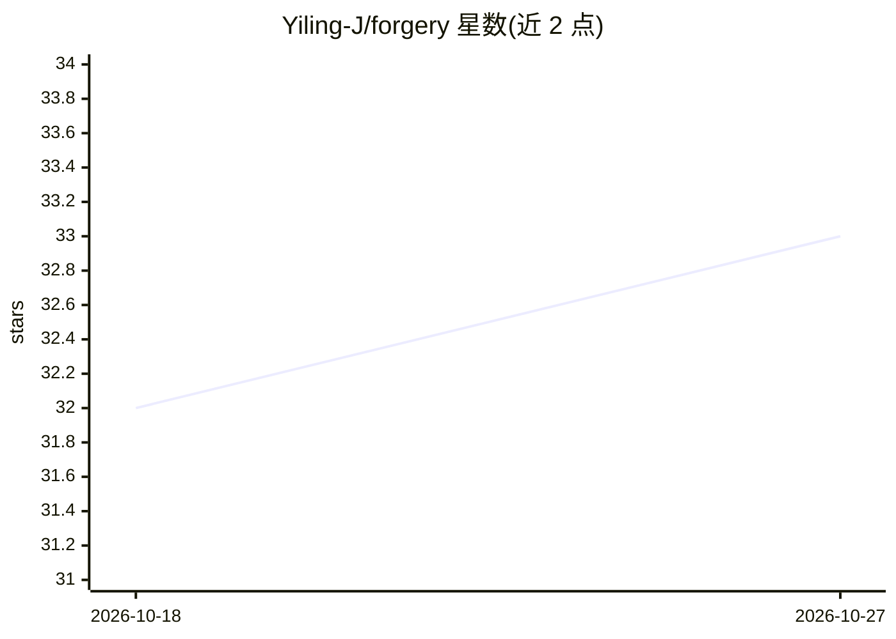

# Yiling-J/forgery

⭐ 33 · TypeScript · MIT · 推送 2026-03-03 · [GitHub](https://github.com/Yiling-J/forgery) · 个人维护 · 中文 README

**从角色图像提取装备素材并用 AI 生成新造型的 Web 应用**

基于 Bun + Hono + React 的自托管 Web 应用：上传角色图像，由 AI 分析并逐件提取道具、服装等装备为可复用素材；再结合基础肖像、姿态与表情控制，通过 AI 图像生成服务产出新的角色造型。数据（素材库、角色、生成历史）存储在本地 SQLite 与文件目录，可通过复制 data 目录备份。运行依赖 OpenAI 或 Google Gemini 的 API Key，文本与图像生成模型可在设置页配置，README 并给出各环节的模型选择建议。

## 筛选速览

| 维度 | 判定 | 备注 |
|---|---|---|
| AI 角色 | `ai-native` | 本体是模型或模型工具 |
| 许可风险 | `permissive` | MIT |
| 部署形态 | `self-host` | docker 或自建部署 |
| 模型依赖 | — | README 未给出锁定关系 |
| 硬件要求 | — | 无带数字的原话,不猜 |
| 安装摩擦 | `low` | 无编译、无系统依赖或容器化 |
| 成熟度 | — | 结构信号不足 |

## 能力要点

- 从截图、cosplay 照片等图像中逐件提取装备为模块化素材
- Fitting Room 组合角色、装备、姿态与表情后生成新造型
- 支持 Bun 本地运行与 Docker（Compose/Standalone）两种部署方式
- 数据本地存储（SQLite + data 目录），可整目录备份恢复

## 适用场景

- 把已有角色截图中的服装道具拆成可复用素材库
- 快速混搭装备、姿态与表情原型多个角色造型
- 自托管一个角色造型生成工具，数据保留在本地

## 场景标签

`图像生成` · 领域:内容生成

## 证据(README 行号)

> L9: Forge characters, not chaos. Forgery helps you extract equipments (props, clothing, accessories) from character imag
> L19: 1. **Extractor**: Upload an image. Forgery analyzes it to identify extractable items. Select what you want, and For
> L95:  - Orchestrates AI models (OpenAI/Gemini) to analyze images and generate masks.

## 星数曲线

2026-10-18 32 → 2026-10-27 33（+1）

---
*卡片 v1 · prompt 1.4 · 生成 2026-10-26 · 置信度 high · 依据 README sha `afe4b1c42302` · [字段定义](../../DATASET.md)*
