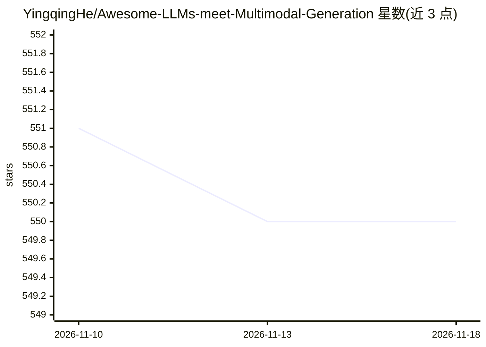

# YingqingHe/Awesome-LLMs-meet-Multimodal-Generation

⭐ 550 · HTML · 推送 2026-11-10 · [GitHub](https://github.com/YingqingHe/Awesome-LLMs-meet-Multimodal-Generation) · 个人维护

**LLM 多模态生成论文清单：图像/视频/3D/音频方向**

作为综述 'LLMs Meet Multimodal Generation and Editing' 的配套仓库，策展 LLM 相关多模态生成论文，模态覆盖视觉（图像、视频、3D）与音频（声音、语音、音乐）。条目按模态与子方向（如 LLM-based 图像生成）组织，每条含日期、作者、Paper/Code/Project_Page/Demo 链接，部分条目带 tokenizer、customization 等标签。提供目录跳转、按作者名 ctrl+F 检索、按标签检索三种浏览方式，接受社区 pull request 补充。可见部分为 Image Generation 章节，含数十篇论文。

## 筛选速览

| 维度 | 判定 | 备注 |
|---|---|---|
| AI 角色 | `ai-knowledge` | 知识聚合/清单类 |
| 许可风险 | `none` | — |
| 部署形态 | `None` |  |
| 模型依赖 | — | README 未给出锁定关系 |
| 硬件要求 | — | 无带数字的原话,不猜 |
| 安装摩擦 | `low` | 无编译、无系统依赖或容器化 |
| 成熟度 | — | 结构信号不足 |

## 能力要点

- 覆盖图像/视频/3D/音频多模态生成方向的论文条目
- 每条含发表日期、作者与 Paper/Code/Project_Page 等链接
- 支持目录跳转、作者名检索与标签（customization/tokenizer 等）筛选

## 适用场景

- 查找 LLM 多模态生成方向的论文与代码
- 按子方向或标签浏览某类工作（如 tokenizer、定制化生成）
- 通过 pull request 收录自己的新工作

## 场景标签

`精选清单` · 领域:学习与行业

## 证据(README 行号)

> L1: LLMs Meet Multimodal Generation and Editing: A Survey
> L4: - This repository contains a curated list of **LLMs meet multimodal generation**. Modalities consist of visual (incl

## 星数曲线

2026-11-10 551 → 2026-11-18 550（-1）

---
*卡片 v1 · prompt 1.4 · 生成 2026-11-17 · 置信度 high · 依据 README sha `d64d73bd703b` · [字段定义](../../DATASET.md)*
