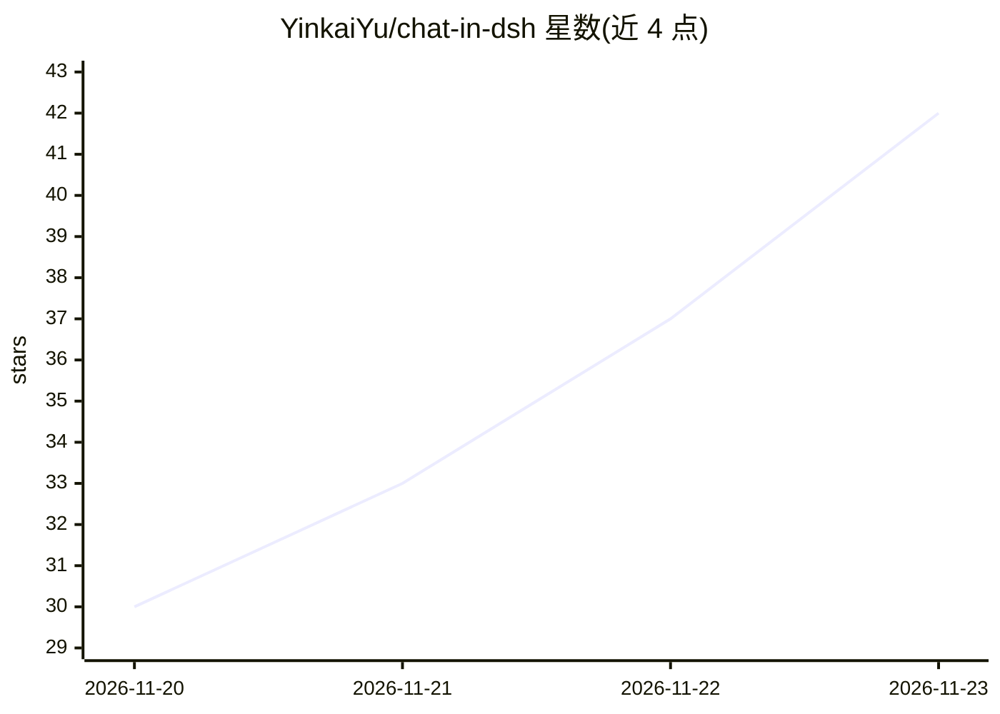

# YinkaiYu/chat-in-dsh

⭐ 42 · JavaScript · MIT · 推送 2026-11-21 · [GitHub](https://github.com/YinkaiYu/chat-in-dsh) · 个人维护 · 中文 README

**在 DeepSeek Harness 里复刻 DeepSeek 网页版聊天的插件**

面向因官网限额转入 DeepSeek Harness（DSH）的聊天/写作用户：以 DSH 插件形式安装，在独立面板内提供基于官方开源 chat-demo 的网页版界面，直接使用 DSH 已登录账户、请求走 API 计费，提供智能搜索、深度思考、引用角标、公式与图表等能力。补齐了会话搜索、轮次进度条、置顶批量管理、长文本转附件、语音输入与朗读等官网交互；面板会话与 DSH 会话分开管理，并支持从官网 ZIP 导出或 DSH 会话导入历史对话。

## 筛选速览

| 维度 | 判定 | 备注 |
|---|---|---|
| AI 角色 | `ai-native` | 本体是模型或模型工具 |
| 许可风险 | `permissive` | MIT |
| 部署形态 | `None` |  |
| 模型依赖 | locked-api |  |
| 硬件要求 | — | 无带数字的原话,不猜 |
| 安装摩擦 | `low` | 无编译、无系统依赖或容器化 |
| 成熟度 | — | 结构信号不足 |

## 能力要点

- 基于官方开源 chat-demo，界面与交互按官网复刻
- 复用 DSH 已登录账户，无需填 API Key，请求走 API 计费
- 支持从官网导出 ZIP 和 DSH 会话两个入口导入历史对话
- 补齐会话搜索、置顶批量管理、语音输入与朗读等交互

## 适用场景

- 在 DSH 中进行不限额的网页版风格聊天与写作
- 把官网历史对话整体迁移到本地面板
- 将 DSH 中的开发对话复制一份用于纯聊天场景

## 场景标签

`聊天机器人` · 领域:对话与助手

## 证据(README 行号)

> L3:  在 DeepSeek Harness（DSH）里，用原汁原味的网页版对话。
> L18: 本插件在 DSH 里加一个独立面板，面板里就是原汁原味的 DeepSeek 网页版本身：官方极简系统提示词、官方的服务端工具、官方界面。在这小小的一方天地，只有 DeepSeek，没有 Harness，它不再被工具束缚，也不再有限
> L22: - **原汁原味**：界面就是 DeepSeek 官方开源的那份前端，交互、排版、动效都按官网复刻

## 星数曲线

2026-11-20 30 → 2026-11-23 42（+12）

---
*卡片 v1 · prompt 1.4 · 生成 2026-11-20 · 置信度 high · 依据 README sha `896eb98c80a0` · [字段定义](../../DATASET.md)*
