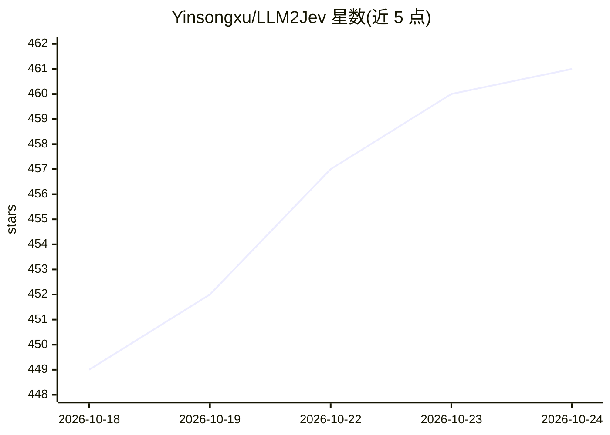

# Yinsongxu/LLM2Jev

⭐ 461 · Python · Apache-2.0 · 推送 2026-10-16 · [GitHub](https://github.com/Yinsongxu/LLM2Jev) · 个人维护 · 中文 README

**把本地 LLM/MLLM 免训练变为 Jev 式结构化决策模型的工具**

LLM2Jev 是一个 Python 项目：让现有模型权重在不训练、不微调的前提下执行分类、打分与动作选择，从文本和图像输出决策概率。核心机制是 prefill-only 读取 yes/no logits（Choice/Score/Noul 四类问题可混合请求，Box 生成图像归一化边界框），而非逐 token 生成。支持 SGLang、Transformers、MLX 三种后端，chat 与决策共用同一服务；客户端扩展 OpenAI Python SDK 增加 systemone.create()。MLX 限定 Apple Silicon，SGLang 路径需 NVIDIA GPU。

## 筛选速览

| 维度 | 判定 | 备注 |
|---|---|---|
| AI 角色 | `ai-ecosystem` | LLM/agent 周边工具 |
| 许可风险 | `permissive` | Apache-2.0 |
| 部署形态 | `library` | 以包/库形式分发 |
| 模型依赖 | — | README 未给出锁定关系 |
| 硬件要求 | — | 无带数字的原话,不猜 |
| 安装摩擦 | `low` | 无编译、无系统依赖或容器化 |
| 成熟度 | — | 结构信号不足 |

## 能力要点

- 零训练：直接用现有模型权重产出决策概率
- prefill-only 评分读取 yes/no logits，不生成答案文本
- SGLang / Transformers / MLX 三种后端，chat 与决策共用同一服务与模型
- 共享前缀复用：SGLang Radix Cache 与 MLX 显式前缀 prefill

## 适用场景

- 把本地模型接入分类、打分与动作选择任务，无需微调
- 文本+图像多模态决策（如 Sokoban 单步动作评估）
- 在 chat 服务之外低成本获取结构化决策概率

## 场景标签

`多模态` · 领域:感知与多模态

## 证据(README 行号)

> L14: Put your existing model weights to work on classification, scoring, and action selection from text and images. Get 
> L37: - **Chat and decisions share a client:** `Client` and `AsyncClient` extend the OpenAI Python SDK with `systemone.cr
> L60: llm2jev-serve --backend sglang --model-path /path/to/model \

## 星数曲线

2026-10-18 449 → 2026-10-24 461（+12）

---
*卡片 v1 · prompt 1.4 · 生成 2026-10-21 · 置信度 high · 依据 README sha `44de9f3f1617` · [字段定义](../../DATASET.md)*
