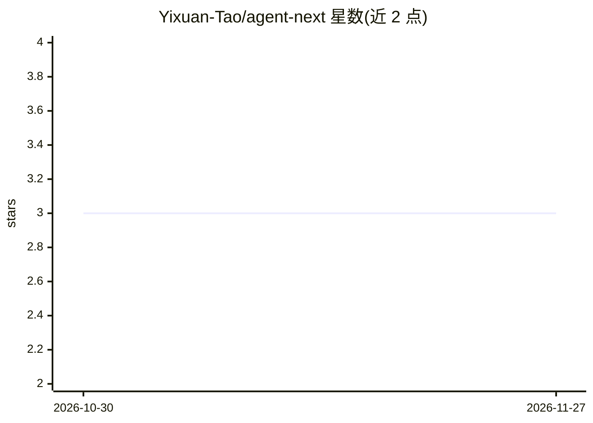

# Yixuan-Tao/agent-next

⭐ 3 · Java · 推送 2026-10-22 · [GitHub](https://github.com/Yixuan-Tao/agent-next) · 个人维护 · 中文 README

**Android 手机 Agent 原型：用户继续用手机，Agent 在私有虚拟屏操作真实 App**

面向 Android 的 GUI Agent 原型项目：用 Shizuku user service 创建私有虚拟屏，把目标 App 的 task 移入该屏，Agent 基于实时界面逐动作决策，在不切换前台、不抢焦点与输入法的条件下完成多步任务，目标 App 按 UID 静音。完成动作由独立核验器判定，支付/登录等风险动作停在边界以非抢屏通知请求人工接管，不提交订单或付款。定位为研发原型（比赛提交作品），六条硬性要求中仅设备权限一项为满足，任务验收仅在单台平板、单 ROM 上完成。

## 筛选速览

| 维度 | 判定 | 备注 |
|---|---|---|
| AI 角色 | `ai-native` | 本体是模型或模型工具 |
| 许可风险 | `none` | — |
| 部署形态 | `None` |  |
| 模型依赖 | locked-api |  |
| 硬件要求 | — | 无带数字的原话,不猜 |
| 安装摩擦 | `medium` | 含编译或系统依赖之一 |
| 成熟度 | `idea` | |

## 能力要点

- Shizuku 私有虚拟屏 + 定向输入，用户主屏与输入法不受影响
- 独立核验器判定任务完成，模型 Done 不直接算成功
- 支付/下单/发送等边界以非抢屏通知请求人工接管
- 纯 GUI 路线：只用语义动作与节点编号，不给坐标

## 适用场景

- 在用户正常使用手机的同时让 Agent 在后台完成购物等 App 内任务
- 需要不抢占前台与焦点的移动端 GUI 自动化
- 支付/登录等敏感动作需要人工接管的 Agent 流程

## 场景标签

`GUI 自动化` · 领域:效率与自动化

## 证据(README 行号)

> L20: - **做什么**：用户用自然语言下达任务，Agent 根据实时界面逐动作决策，在真实第三方 App（当前验证：夸克）完成多步操作，最后给出可核验结果，或明确停在哪个边界、需要用户做什么。
> L21: - **怎么做**：用 Shizuku user service 创建私有虚拟屏 → 把目标 App 的 task 移入该屏 → 只对该屏观察与定向输入 → 目标 App 按 UID 静音。用户的主屏、焦点和输入法完全不受影响。
> L95: - **循环**：`observe → 模型选一个动作 → 执行器重新定位并校验 → 回读新页面 → 判断效果`。失败反馈进入下一轮；相同页面上已失败/无效果的相同动作会被拦截；页面变化不等于任务完成。

## 星数曲线

2026-10-30 3 → 2026-11-27 3（+0）

---
*卡片 v1 · prompt 1.4 · 生成 2026-11-22 · 置信度 high · 依据 README sha `d7c6baa62900` · [字段定义](../../DATASET.md)*
