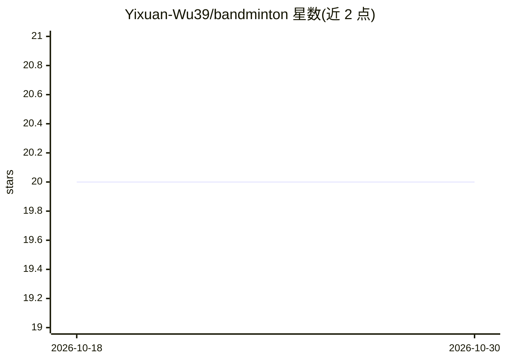

# Yixuan-Wu39/bandminton

⭐ 20 · JavaScript · MIT · 推送 2026-08-12 · [GitHub](https://github.com/Yixuan-Wu39/bandminton) · 个人维护 · 中文 README

**小米手环上的羽毛球挥拍动作分类与训练工具链**

面向小米 Vela 可穿戴设备的 Vela JS 快应用与数据工具链：在设备端用轻量分类器与状态机，基于三轴加速度计轨迹将挥拍分为正/反手高/低四类，并做会话级强度汇总；另提供采集、去重、特征提取、训练、打包的 Node.js 脚本。限制：当前仅适配右手佩戴，仅小米手环 9 Pro 有验证路径，不测量拍速、卡路里或医疗指标；界面为中文。内部评估报告 90.8% 准确率，作者声明仅为开发信号。

## 筛选速览

| 维度 | 判定 | 备注 |
|---|---|---|
| AI 角色 | `ai-native` | 本体是模型或模型工具 |
| 许可风险 | `permissive` | MIT |
| 部署形态 | `library` | 以包/库形式分发 |
| 模型依赖 | — | README 未给出锁定关系 |
| 硬件要求 | — | 无带数字的原话,不猜 |
| 安装摩擦 | `low` | 无编译、无系统依赖或容器化 |
| 成熟度 | `idea` | |

## 能力要点

- 设备端轻量轨迹分类器 + 状态机，四类挥拍结构分类
- Node.js 可复现脚本：数据恢复、特征提取、训练、验证、上带打包
- 独立的连续加速度数据采集应用
- 明确的安全边界：不刷机、手动启动采集

## 适用场景

- 在手环上实时识别挥拍类型并获得反馈
- 自采数据训练和验证自己的挥拍分类模型
- 将设计移植到其他手环/手表平台

## 场景标签

 · 领域:可穿戴/运动分析

## 证据(README 行号)

> L25: - A Vela JS main application for on-device swing feedback and session portraits.
> L30: - A lightweight, on-device trajectory model and state machine.

## 星数曲线

2026-10-18 20 → 2026-10-30 20（+0）

---
*卡片 v1 · prompt 1.4 · 生成 2026-10-28 · 置信度 high · 依据 README sha `a14f519f84f2` · [字段定义](../../DATASET.md)*
