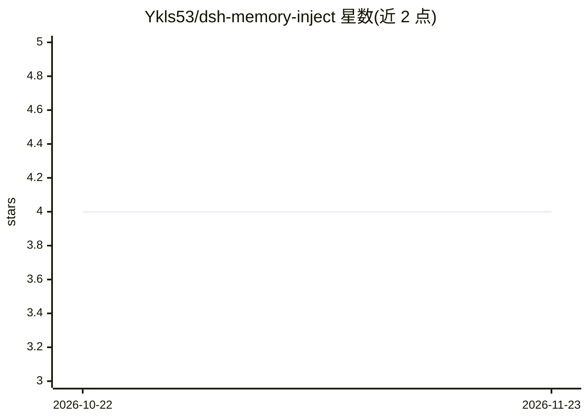

# Ykls53/dsh-memory-inject

⭐ 4 · JavaScript · MIT · 推送 2026-11-13 · [GitHub](https://github.com/Ykls53/dsh-memory-inject) · 个人维护 · 中文 README

**给 DeepSeek Harness 加三层持久记忆的插件**

一个挂载在 DeepSeek Harness（DSH）进程上的 cordis 插件，为 agent 提供四层记忆：USER.md/MEMORY.md 常驻事实（带字符硬上限）、每会话摘要、全文检索（SQLite FTS5 trigram，支持中文）与离线生成的主题 wiki 地图。注入阶段读文件拼字符串，零模型调用、无网络；自动回填与做梦整理通过宿主 headless 会话或宿主 llm 服务调用用户已选模型完成，写前自动备份并限制删除比例。安装方式为 dsh plugin add，配置走 cordis.patch.yml 与设置面板。

## 筛选速览

| 维度 | 判定 | 备注 |
|---|---|---|
| AI 角色 | `ai-ecosystem` | LLM/agent 周边工具 |
| 许可风险 | `permissive` | MIT |
| 部署形态 | `desktop` | 安装包/桌面程序 |
| 模型依赖 | locked-api |  |
| 硬件要求 | — | 无带数字的原话,不猜 |
| 安装摩擦 | `low` | 无编译、无系统依赖或容器化 |
| 成熟度 | — | 结构信号不足 |

## 能力要点

- 注入零模型调用，无 LLM/embedding/网络
- 三层记忆：常驻事实 + 会话摘要 + FTS5 trigram 全文检索（支持中文）
- wiki 主题索引只注入一行，正文留在磁盘按需取用
- 做梦整理只报增量操作、写前自动备份并限制删除比例

## 适用场景

- 让 DSH agent 记住用户偏好与环境事实，跨会话可查
- 按时间窗检索过去的会话内容
- 离线整理与核对已有记忆条目

## 场景标签

`Agent 记忆` · 领域:Agent 开发

## 证据(README 行号)

> L3: **给 DeepSeek Harness 加一套「记得住」的记忆：三层常驻 + 一张记忆地图，一处也不用你操心。**
> L8: > Layered memory for DeepSeek Harness: always-on curated facts (`USER.md` /
> L104: 而这个 agent 读 `~/.dsh/settings.yaml` 的 `agent-default-model` ——

## 星数曲线

2026-10-22 4 → 2026-11-23 4（+0）

---
*卡片 v1 · prompt 1.4 · 生成 2026-11-21 · 置信度 high · 依据 README sha `3f6eda9f63dd` · [字段定义](../../DATASET.md)*
