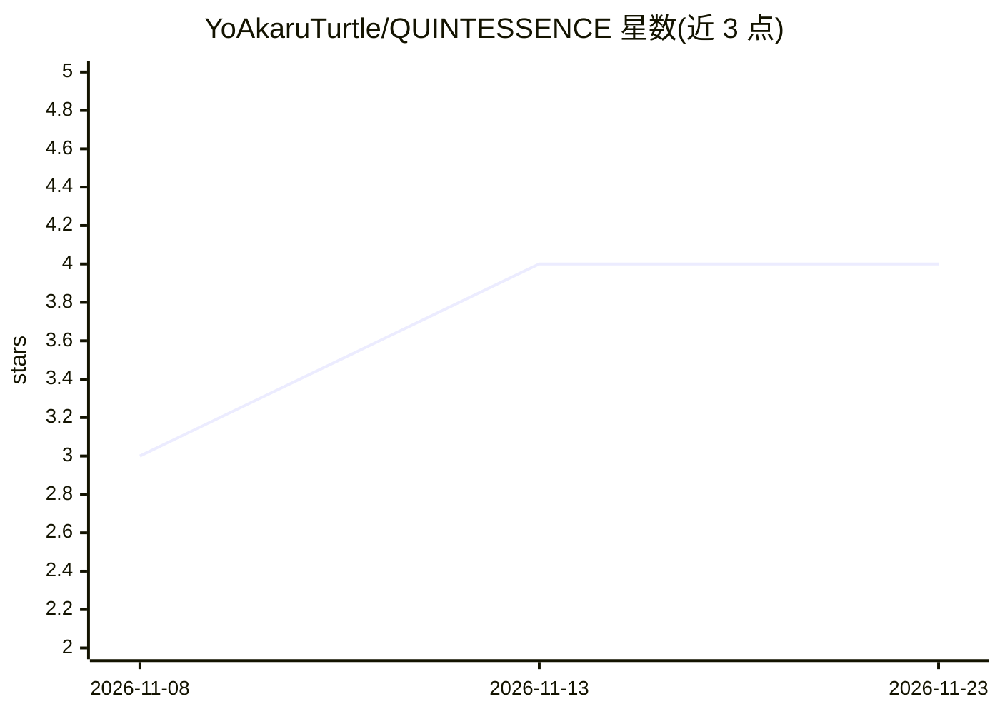

# YoAkaruTurtle/QUINTESSENCE

⭐ 4 · Python · Apache-2.0 · 推送 2026-11-21 · [GitHub](https://github.com/YoAkaruTurtle/QUINTESSENCE) · 个人维护 · 中文 README

**给个人 AI 提供跨会话持久认知状态的研究系统**

QUINTESSENCE 是一个持久认知系统（PCS）研究项目：将可替换的 LLM 与长期 Persona、Memory、Cognition 组合，由可信宿主管理；持久状态、证据关系与信念修订存于模型之外，模型输出被视为待审候选，须通过规则检查才能成为持久信念。支持信念版本化撤回/替换、形式化 Context 组装、实例文件夹迁移与恢复。处于早期研究阶段，Windows 平台经本地测试，无签名公开二进制发布；核心使用 Python 标准库，Python 3.12+。

## 筛选速览

| 维度 | 判定 | 备注 |
|---|---|---|
| AI 角色 | `ai-native` | 本体是模型或模型工具 |
| 许可风险 | `permissive` | Apache-2.0 |
| 部署形态 | `None` |  |
| 模型依赖 | — | README 未给出锁定关系 |
| 硬件要求 | — | 无带数字的原话,不猜 |
| 安装摩擦 | `low` | 无编译、无系统依赖或容器化 |
| 成熟度 | `idea` | |

## 能力要点

- 信念修订链：证据、作用域、版本化撤回与替换，保留修订原因
- PCS 持有认知状态、模型仅参与推理、宿主负责执行的三方分工
- 实例文件夹 A/B/C：空文件夹初始化、完整迁移/重启、部分损坏显式处理
- 双语文档与 Persona/SDRPE、Scope Recall 记忆集成

## 适用场景

- 研究如何让 AI 的经历与信念跨会话延续并按证据修订
- 构建带证据溯源与审计边界的个人 AI 持久状态
- 在 Windows 本地运行可迁移、可恢复的私有 AI 实例

## 场景标签

`Agent 记忆` `AI 助手` · 领域:Agent 开发

## 证据(README 行号)

> L21: QUINTESSENCE is a general-purpose personal AI persistent-state and cognitive collaboration system. It combines a re
> L96: 3. Configure the supported model endpoint/model and your API credential in Settings. Model service access, authoriz

## 星数曲线

2026-11-08 3 → 2026-11-23 4（+1）

---
*卡片 v1 · prompt 1.4 · 生成 2026-11-21 · 置信度 mid · 依据 README sha `fdbfa33f27c5` · [字段定义](../../DATASET.md)*
