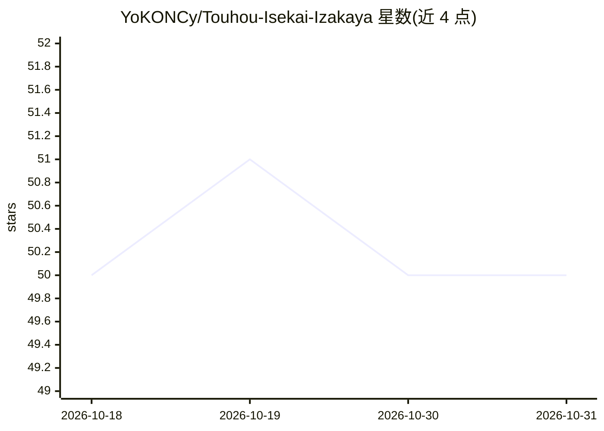

# YoKONCy/Touhou-Isekai-Izakaya

⭐ 50 · HTML · AGPL-3.0 · 推送 2026-08-23 · [GitHub](https://github.com/YoKONCy/Touhou-Isekai-Izakaya) · [官网](https://touhouisk.cn) · 个人维护 · 中文 README

**东方二次创作 Web 游戏：LLM 叙事+居酒屋经营+弹幕战斗**

基于 Vue3+TypeScript 的纯前端 Web 游戏，玩家穿越幻想乡经营居酒屋：角色对话与剧情由 LLM 驱动，四模型分工（Storyteller/Game Master/Scribe/工具），采用 SQLite Wasm+OPFS 本地存储与 PEDSA 联想激活算法构建长期记忆图谱；含回合制弹幕战斗、AI 嘴遁说服判定、WebSocket 联机（AES-GCM 端到端加密）与 NovelAI/OpenAI 剧情插画生成。需自备 OpenAI 格式 API Key，可通过 Capacitor 打包 Android 应用。项目处于 Beta 测试阶段，存档兼容性与经营模块仍在迭代。

## 筛选速览

| 维度 | 判定 | 备注 |
|---|---|---|
| AI 角色 | `ai-native` | 本体是模型或模型工具 |
| 许可风险 | `viral` | AGPL-3.0 |
| 部署形态 | `library` | 以包/库形式分发 |
| 模型依赖 | — | README 未给出锁定关系 |
| 硬件要求 | — | 无带数字的原话,不猜 |
| 安装摩擦 | `medium` | 含编译或系统依赖之一 |
| 成熟度 | `idea` | |

## 能力要点

- 四 LLM 协作架构（叙事/逻辑/记忆/工具）与 XML 结构化指令输出
- SQLite FTS5 + PEDSA 能量扩散激活的联想长期记忆
- 回合制符卡弹幕战斗与 LLM 嘴遁说服系统
- 纯前端 SQLite Wasm+OPFS 本地存储，无需后端服务器

## 适用场景

- 与 AI 驱动的东方角色对话并进行角色扮演剧情
- 经营居酒屋、研究菜谱并与伙伴联机游玩
- 通过源码构建并部署为静态 Web 或 Android 应用

## 场景标签

 · 领域:游戏/互动叙事

## 证据(README 行号)

> L105: **东方异界食堂** 是一款融合了 **LLM (大语言模型)** 叙事、**模拟经营** 与 **RPG 战斗** 的 Web 游戏。
> L111: - **🎭 LLM 驱动的无限叙事**: 每一位角色都由 AI 驱动。角色会根据性格、好感度以及过往记忆与你交流。
> L118: > 本项目不仅仅是一个简单的 LLM 调用程序，而是一个拥有**感知、记忆、决策、行动**完整回路的 **智能体 (Autonomous Agent)**。

## 星数曲线

2026-10-18 50 → 2026-10-31 50（+0）

---
*卡片 v1 · prompt 1.4 · 生成 2026-10-25 · 置信度 high · 依据 README sha `983472b178f5` · [字段定义](../../DATASET.md)*
