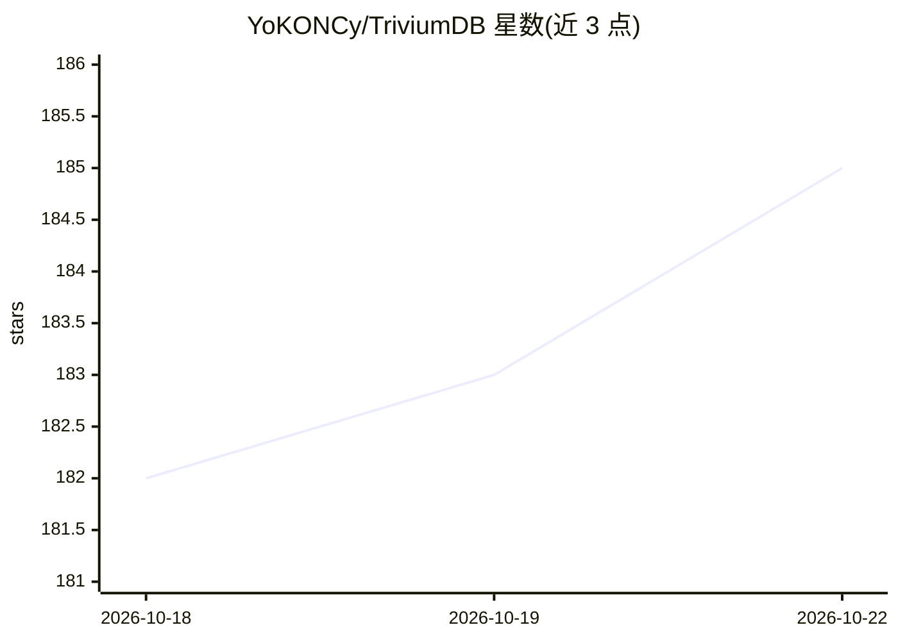

# YoKONCy/TriviumDB

⭐ 185 · Rust · Apache-2.0 · 推送 2026-10-21 · [GitHub](https://github.com/YoKONCy/TriviumDB) · [官网](https://triviumdb.com) · 个人维护 · 中文 README

**Rust 编写的向量×图谱×文档三模嵌入式数据库，面向 AI 应用**

用纯 Rust 编写的嵌入式三模数据库引擎，将向量检索、属性图谱与文档型元数据融合在同一存储内核，节点同时持有稠密向量、稀疏文本倒排、JSON 元数据与图关系。提供 TQL 查询语言（Cascades 优化器）、四类属性索引、内嵌图算法库（PageRank/Leiden/SA-PPR 等）与自研 QuIVer ANN 索引。通过 PyO3 与 napi-rs 提供 Python/Node.js 绑定，pip/npm 安装预编译二进制；另有 nightly 预览的 HTTP Server 与实验性 TSNG 研究轨道。定位单机 AI 应用（Agent 记忆、RAG），不面向高并发分布式场景；建议向量维度不超过 3072。

## 筛选速览

| 维度 | 判定 | 备注 |
|---|---|---|
| AI 角色 | `ai-ecosystem` | LLM/agent 周边工具 |
| 许可风险 | `permissive` | Apache-2.0 |
| 部署形态 | `library` | 以包/库形式分发 |
| 模型依赖 | — | README 未给出锁定关系 |
| 硬件要求 | — | 无带数字的原话,不猜 |
| 安装摩擦 | `low` | 无编译、无系统依赖或容器化 |
| 成熟度 | `idea` | |

## 能力要点

- 向量/图谱/文档三模融合于单一存储内核，同一 NodeId 共享事务与 WAL
- TQL 统一查询语言：向量召回、图扩展、图算法、集合代数可自由编排，含 Prepared 参数化
- 内嵌图算法库（PageRank/WCC/Leiden/Betweenness/SA-PPR 等可在查询内调用）
- QuIVer 自研 ANN 索引，小规模走 rayon 精确暴力搜索，动态阈值 2,500–10,000 节点切换

## 适用场景

- AI Agent 长期记忆：对话存为带向量节点，沿关系链扩散召回
- RAG 上下文编织：混合检索（AC+BM25+稠密向量）+ 图谱扩散
- 个人知识库与小型推荐系统：语义搜索 + 图谱导航一库完成
- 替代向量库+文档库+图库三库同步的拼装方案（单机场景）

## 场景标签

`向量数据库` `Agent 记忆` · 领域:Agent 开发

## 证据(README 行号)

> L15: > “_TriviumDB_ 定位是 AI 应用领域的嵌入式数据库，旨在解决单机环境下 Agent 复杂上下文和多模态记忆编织的痛点。如果是需要支撑千万并发的高可用分布式后端，请依然选择大型集群化组件！”
> L28: 我们的目标是成为 **AI 应用领域的 SQLite**：

## 星数曲线

2026-10-18 182 → 2026-10-22 185（+3）

---
*卡片 v1 · prompt 1.4 · 生成 2026-10-22 · 置信度 high · 依据 README sha `18c3b5e35cfe` · [字段定义](../../DATASET.md)*
