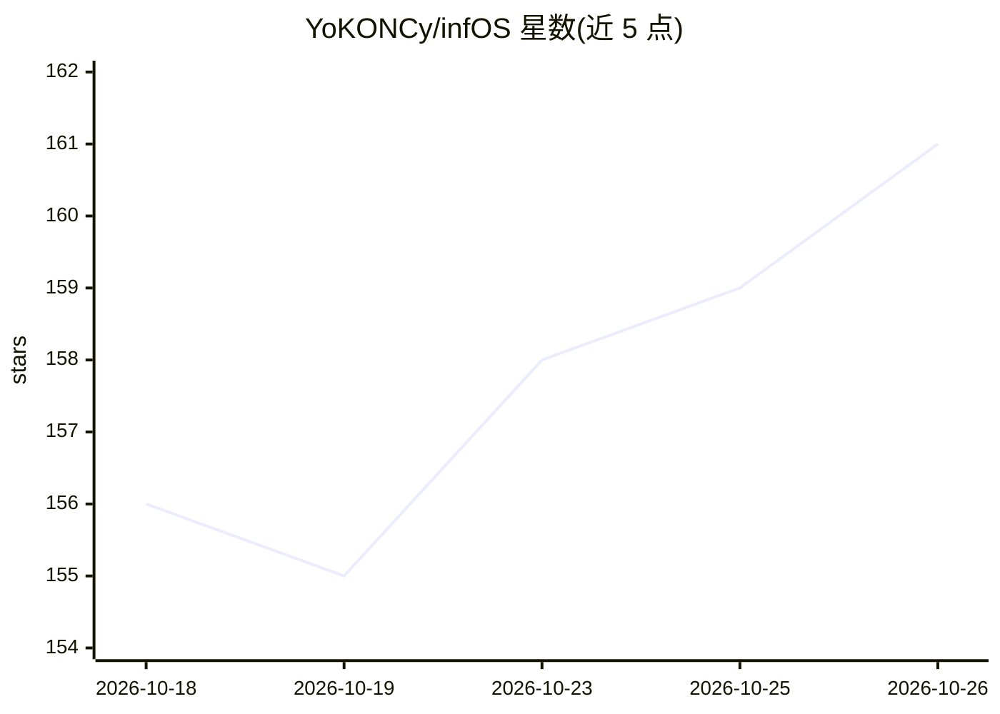

# YoKONCy/infOS

⭐ 161 · TypeScript · Apache-2.0 · 推送 2026-10-25 · [GitHub](https://github.com/YoKONCy/infOS) · 组织维护 · 中文 README

**AI 伙伴运行时内核：长记忆引擎加桌面陪伴应用**

infOS 是以主 Agent 为中心的 AI 工作站与运行时内核，TypeScript 全栈（Hono + Vue 3 + Electron）并用 Rust 编写高性能核心。记忆引擎以 EventNote 事件记事为主体，经候选→门控→正式记忆三层把关，由自研 TriviumDB（向量+图谱一体存储）承载检索，支持向量+BM25 自动 RAG 与可选 SA-PPR 高级管线（含 ContextRNN、Leiden、反馈闭环），主动查询走确定性 BFS。配套 PeroperoChat 桌面应用面向普通用户，提供 3D 桌宠、多角色房间与跨端记忆。能力以 Package（Manifest V2）统一分发，兼容 MCP 协议；后端可脱离桌面单独部署于服务器或 Docker。

## 筛选速览

| 维度 | 判定 | 备注 |
|---|---|---|
| AI 角色 | `ai-ecosystem` | LLM/agent 周边工具 |
| 许可风险 | `permissive` | Apache-2.0 |
| 部署形态 | `desktop` | 安装包/桌面程序 |
| 模型依赖 | — | README 未给出锁定关系 |
| 硬件要求 | — | 无带数字的原话,不猜 |
| 安装摩擦 | `low` | 无编译、无系统依赖或容器化 |
| 成熟度 | — | 结构信号不足 |

## 能力要点

- TriviumDB（Rust）向量+图谱一体存储，1 亿条噪音数据测试中约 2.95ms 检索
- 双模式 RAG：自动向量+BM25 检索与可选 SA-PPR 高级管线（FISTA/DPP/ContextRNN/Leiden/反馈闭环）
- 主 Agent + 子 Agent（上下文持有）架构，子 Agent 结果经记忆门控审核后并入正式记忆
- Package（Manifest V2）统一扩展体系，技能/工具/事件订阅，跨进程模式兼容 MCP 协议

## 适用场景

- 想要一个有长期记忆、跨端统一记忆的 AI 陪伴应用
- 在服务器/Docker 上独立部署 Agent 后端服务
- 通过 Package 体系为 AI 伙伴扩展技能与工具
- 研究带记忆门控与可审计上下文编译的 Agent 运行时架构

## 场景标签

`Agent 记忆` `RAG` `Agent 框架` · 领域:Agent 开发

## 证据(README 行号)

> L18:  infOS 是以主 Agent 为中心的 AI 工作站与运行时内核。 萌动链接：PeroperoChat！ 是它面向日常陪伴的桌面应用。
> L58: PeroperoChat 不仅仅是一个桌宠应用，它是 **Pero** 的"灵魂容器"；而 **infOS** 是承载它的智能运行时内核——一个以"主 Agent"为中心的 AI 工作站。它已从 Python 版全面重写为 **T
> L142: 这一节给想深入了解系统设计的开发者。infOS 并非"套了个 Electron 壳的聊天程序"——它的核心是一套我们称为 **AIOS** 的 Agent 运行时架构，让每个 AI 伙伴都拥有清晰的资源边界，也让系统能被多个客户

## 星数曲线

2026-10-18 156 → 2026-10-26 161（+5）

---
*卡片 v1 · prompt 1.4 · 生成 2026-10-23 · 置信度 mid · 依据 README sha `fe9d781b7e7b` · [字段定义](../../DATASET.md)*
