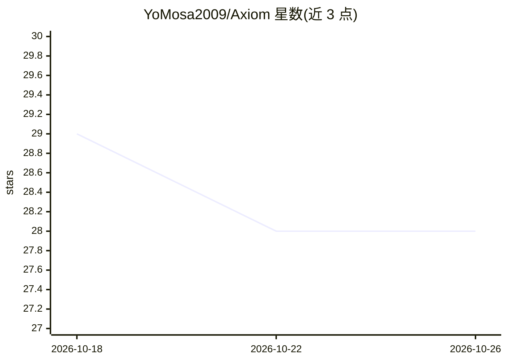

# YoMosa2009/Axiom

⭐ 28 · C# · NOASSERTION · 推送 2026-10-12 · [GitHub](https://github.com/YoMosa2009/Axiom) · [官网](axiominference.work) · 个人维护

**Windows 本地优先 AI 助手与多智能体工作台**

面向 Windows 10/11 的桌面 AI 助手应用，支持三种模型接入方式：本地经 llama.cpp 运行 GGUF 模型、指向自托管 OpenAI 兼容端点、或经 OpenRouter 使用云端模型（自带 key）。提供单模型 Chat、三角色 Council（Architect/Builder/Critic）工作流、Computer Use 桌面操作、Computer Agent 文件/命令执行（手动/自动两种审批模式）、Python/Java 沙箱、Web 搜索、Skills 与 Project Canvas 产物渲染。按模型参数量自适应上下文预算与工具协议，小模型（sub-4B）降级为文本协议。数据存储在 %LOCALAPPDATA%\Axiom，以一键安装包或免安装 ZIP 分发，免费无订阅。

## 筛选速览

| 维度 | 判定 | 备注 |
|---|---|---|
| AI 角色 | `ai-native` | 本体是模型或模型工具 |
| 许可风险 | `none` | NOASSERTION |
| 部署形态 | `desktop` | 安装包/桌面程序 |
| 模型依赖 | local-ok | 支持本地模型 |
| 硬件要求 | — | 无带数字的原话,不猜 |
| 安装摩擦 | `medium` | 含编译或系统依赖之一 |
| 成熟度 | — | 结构信号不足 |

## 能力要点

- 三种模型接入：本地 GGUF（llama.cpp）、自托管端点、OpenRouter 云端
- Council 三角色（规划/产出/审查）与 Computer Use 桌面操作
- Computer Agent 提供 8 种文件/命令工具，含手动审批与高危操作拒绝清单
- 按模型参数量自适应上下文预算与工具路由，sub-4B 模型降级协议

## 适用场景

- 在 Windows 上离线运行本地 GGUF 模型做日常对话与文档处理
- 用多角色 Council 工作流完成需要多轮迭代的任务
- 让 Agent 在受控范围内代为执行命令、读写文件并核验结果

## 场景标签

`AI 助手` `多智能体` `GUI 自动化` · 领域:Agent 开发

## 证据(README 行号)

> L3: **A free, local-first AI assistant and agentic workspace for Windows.**
> L29: |**Local**|Your GPU/CPU via llama.cpp|A GGUF model|Full privacy, offline work, no per-token cost|

## 星数曲线

2026-10-18 29 → 2026-10-26 28（-1）

---
*卡片 v1 · prompt 1.4 · 生成 2026-10-26 · 置信度 high · 依据 README sha `1ed53f11aec4` · [字段定义](../../DATASET.md)*
