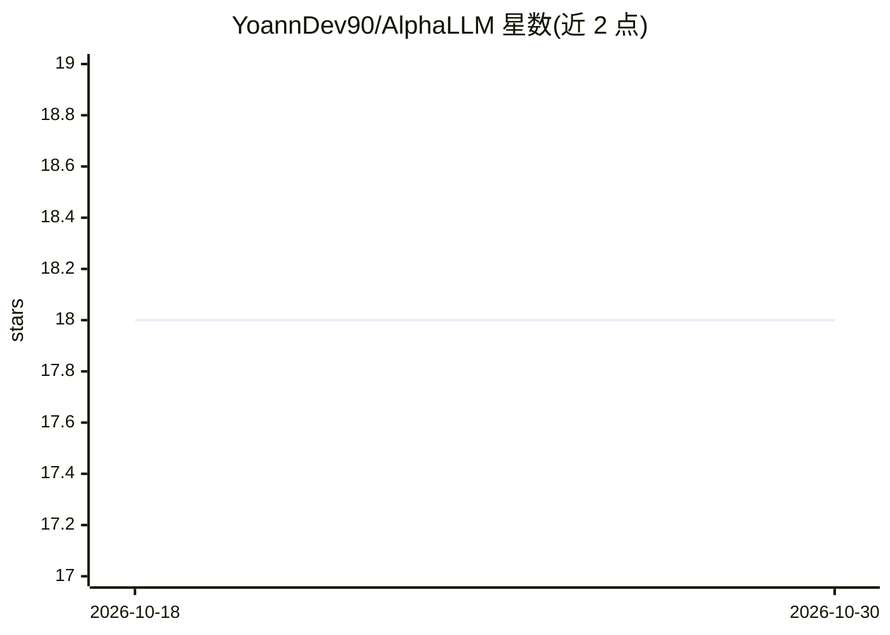

# YoannDev90/AlphaLLM

⭐ 18 · Python · MIT · 推送 2026-06-10 · [GitHub](https://github.com/YoannDev90/AlphaLLM) · 个人维护

**集成多 AI 模型做文本与图片生成的 Discord 机器人**

面向 Discord 服务器管理者的 Python 机器人：接入 ChatGPT、Claude、DeepSeek、Gemini、GLM、Grok、Llama、Mistral、Qwen、Sonar 等多个模型，提供文本与图片生成、RAG 记忆系统、自动模型选择以及日志诊断功能。配置通过 config.toml 与 .env（存放各服务商 API key）完成；要求 Python 3.12+、各服务商 API key、2 GB 内存与 5 GB 磁盘。以 MIT 许可发布。

## 筛选速览

| 维度 | 判定 | 备注 |
|---|---|---|
| AI 角色 | `ai-native` | 本体是模型或模型工具 |
| 许可风险 | `permissive` | MIT |
| 部署形态 | `None` |  |
| 模型依赖 | — | README 未给出锁定关系 |
| 硬件要求 | — | 无带数字的原话,不猜 |
| 安装摩擦 | `low` | 无编译、无系统依赖或容器化 |
| 成熟度 | — | 结构信号不足 |

## 能力要点

- 文本与图片生成的 Discord 机器人
- RAG 记忆系统与运行时配置中的记忆模型
- 支持十余种 AI 模型并自动选择
- 日志与诊断功能

## 适用场景

- 在 Discord 服务器中调用多个 AI 模型进行对话与图片生成
- 为机器人维护跨会话的 RAG 记忆
- 通过配置切换不同 AI 服务商

## 场景标签

`聊天机器人` `图像生成` · 领域:对话与助手

## 证据(README 行号)

> L12: AlphaLLM is an advanced Discord bot that integrates multiple AI models for text and image generation. It provides a
> L16: - 🤖 Discord bot with text and image generation

## 星数曲线

2026-10-18 18 → 2026-10-30 18（+0）

---
*卡片 v1 · prompt 1.4 · 生成 2026-10-29 · 置信度 high · 依据 README sha `1be054e66c7e` · [字段定义](../../DATASET.md)*
