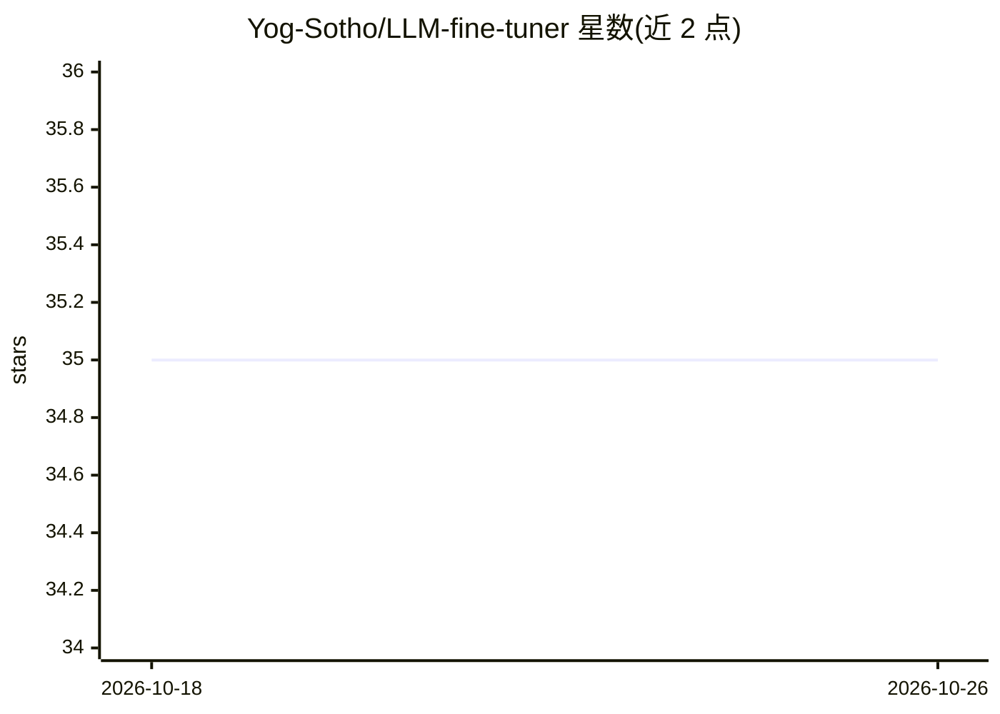

# Yog-Sotho/LLM-fine-tuner

⭐ 35 · Python · GPL-3.0 · 推送 2026-10-24 · [GitHub](https://github.com/Yog-Sotho/LLM-fine-tuner) · [官网](https://yog-sotho.github.io/LLM-fine-tuner/) · 个人维护

**无代码 LLM 微调工具：上传数据点击训练得到可导出模型**

面向无编程经验用户的本地 LLM 微调应用：通过浏览器中的 Gradio 界面上传 CSV/Excel/PDF 等数据（或用 AI 从文档生成问答对），选择预设后进行 SFT/DPO/ORPO/KTO/GRPO/蒸馏及嵌入模型训练，也提供 CLI 与 Docker 镜像。底层使用 Unsloth 加速与 QLoRA，支持多 GPU（FSDP/DeepSpeed）；训练完成的模型可导出为 ZIP、发布到 HuggingFace Hub、导出 GGUF 供 Ollama/LM Studio 使用或以 vLLM 部署。含 Heretic Mode 一键移除模型内置限制。GPL-3.0 许可。

## 筛选速览

| 维度 | 判定 | 备注 |
|---|---|---|
| AI 角色 | `ai-ecosystem` | LLM/agent 周边工具 |
| 许可风险 | `viral` | GPL-3.0 |
| 部署形态 | `library` | 以包/库形式分发 |
| 模型依赖 | local-ok | 支持本地模型 |
| 硬件要求 | — | 无带数字的原话,不猜 |
| 安装摩擦 | `low` | 无编译、无系统依赖或容器化 |
| 成熟度 | — | 结构信号不足 |

## 能力要点

- 无代码 Gradio 界面完成 SFT/DPO/ORPO/KTO/GRPO/蒸馏/嵌入模型训练
- Unsloth 加速与 QLoRA，8GB 显存即可运行
- 导出 GGUF 供 Ollama/LM Studio 离线使用，或 vLLM 部署，可发布到 HuggingFace Hub
- 多 GPU 预设（DDP/FSDP2/DeepSpeed ZeRO-2/3）与视觉模型、MoE 支持

## 适用场景

- 不懂编程也能用自己的数据微调一个专属模型
- 训练客服机器人、写作风格助手或领域问答模型
- 微调嵌入模型改进 RAG 检索效果并对比前后分数

## 场景标签

`微调` · 领域:训练与推理

## 证据(README 行号)

> L28: LLM Fine-Tuner lets you do it through a simple visual interface. No programming knowledge needed. If you can use a 
> L158: |**Standard Training (SFT)**|Teaches the model using your question-answer examples|Starting point for almost every
> L166: Large models: multi-GPU presets for DDP, FSDP2, FSDP + QLoRA and DeepSpeed ZeRO-2/3

## 星数曲线

2026-10-18 35 → 2026-10-26 35（+0）

---
*卡片 v1 · prompt 1.4 · 生成 2026-10-25 · 置信度 high · 依据 README sha `ca1803952fb9` · [字段定义](../../DATASET.md)*
