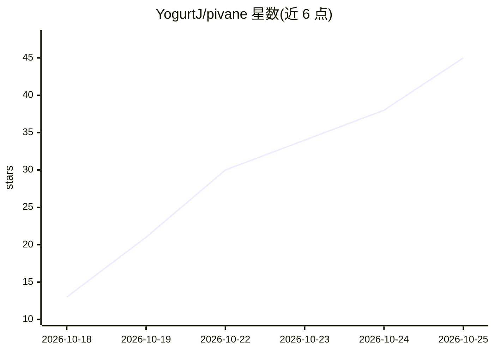

# YogurtJ/pivane

⭐ 49 · JavaScript · ISC · 推送 2026-10-24 · [GitHub](https://github.com/YogurtJ/pivane) · [官网](https://github.com/YogurtJ/pivane#readme) · 个人维护 · 中文 README

**Pi 编程 Agent 的自托管网页工作台，多端续用**

在自有服务器上运行 Pi coding agent 的原生运行时，通过浏览器在桌面/平板/手机使用同一会话（每线程由一个 Pi worker 进程服务）。功能含子代理、定时任务（cron/一次性）、MCP、助手长期记忆（pi-hermes-memory）、WeChat 连接器、文件预览与 diff、以及可接入自有图像/视频/语音服务的媒体实验室。会话直接读写 Pi 的 JSONL 文件，与 Pi CLI 共享身份。定位个人单用户实例，需 Node.js 22 与 ripgrep，无需 GPU、构建步骤或 Docker。

## 筛选速览

| 维度 | 判定 | 备注 |
|---|---|---|
| AI 角色 | `ai-ecosystem` | LLM/agent 周边工具 |
| 许可风险 | `permissive` | ISC |
| 部署形态 | `None` |  |
| 模型依赖 | — | README 未给出锁定关系 |
| 硬件要求 | — | 无带数字的原话,不猜 |
| 安装摩擦 | `low` | 无编译、无系统依赖或容器化 |
| 成熟度 | — | 结构信号不足 |

## 能力要点

- 运行 Pi 原生运行时并读写其 JSONL 会话文件，与 Pi CLI 兼容
- 子代理、任务线程、线程间消息与 cron 定时任务
- 内置图像/视频/语音实验室，接入 OpenAI、Gemini、火山方舟、阿里云百炼等
- 支持多个模型提供商（Anthropic、OpenAI、Gemini、DeepSeek、Qwen、Kimi 等）与自定义 OpenAI 兼容端点

## 适用场景

- 在电脑上开始编程任务、手机上继续跟进
- 让多个子代理并行检查代码、测试与文档
- 通过微信私聊向 Agent 交办任务并接收文件
- 自托管地管理模型密钥、会话历史与用量成本

## 场景标签

`编码 Agent` `多智能体` `Agent 记忆` · 领域:Agent 开发

## 证据(README 行号)

> L7: Run the Pi coding agent on your own machine and use it from any browser on your desktop, tablet or phone.
> L27: - **Your models, your keys, your machine.** You can use any provider Pi supports, including Anthropic, OpenAI, Goog

## 星数曲线

2026-10-18 13 → 2026-10-25 45（+32）

---
*卡片 v1 · prompt 1.4 · 生成 2026-10-25 · 置信度 high · 依据 README sha `3acddb0e2d1f` · [字段定义](../../DATASET.md)*
