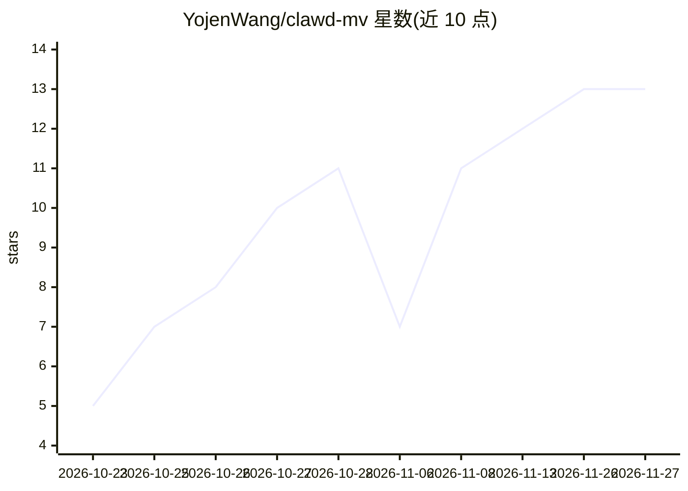

# YojenWang/clawd-mv

⭐ 13 · Python · NOASSERTION · 推送 2026-11-14 · [GitHub](https://github.com/YojenWang/clawd-mv) · 个人维护 · 中文 README

**让 AI 按固定流程为一首歌生成手绘动画 MV 的技能包**

包含一份 292 行的 SKILL.md 与一个无头渲染器：把「40–60 个镜头、每镜有节拍、画面咬住歌词」写成可执行流程，交给会写代码的模型执行，最终渲染成 MP4。流程含故事板、逐句时间轴、四层运动与镜头三行填写等硬性规则，多数规则来自用户反馈。渲染器基于 Edge headless + CDP，支持抽单帧检查；仅支持 Windows + Edge，无内置示例项目，不生成音乐也不分析音频。

## 筛选速览

| 维度 | 判定 | 备注 |
|---|---|---|
| AI 角色 | `ai-native` | 本体是模型或模型工具 |
| 许可风险 | `none` | NOASSERTION |
| 部署形态 | `library` | 以包/库形式分发 |
| 模型依赖 | — | README 未给出锁定关系 |
| 硬件要求 | — | 无带数字的原话,不猜 |
| 安装摩擦 | `low` | 无编译、无系统依赖或容器化 |
| 成熟度 | — | 结构信号不足 |

## 能力要点

- 292 行 SKILL.md 把歌曲切成 40–60 个镜头并规定每镜动作节拍
- 「四层运动」硬性要求：角色表演/次要动作/环境生命/摄影机缺一即死镜头
- 每镜强制填写「想要/阻碍/结果」三行剧情
- Edge headless + CDP 无头渲染器，支持抽单帧检查构图

## 适用场景

- 让 AI 读完流程后为一首歌生成手绘风格动画 MV
- 用无头渲染器逐帧自检画面构图与运动
- 把整套 MV 制作规则作为可复用的 AI 技能放进技能目录

## 场景标签

`视频生成` · 领域:内容生成

## 证据(README 行号)

> L3: **给一首歌做手绘动画 MV —— 把这件事变成 AI 能直接执行的流程。**
> L15: 是一个**技能包**：一份 292 行的 `SKILL.md` + 一个无头渲染器。你把 `SKILL.md` 给一个会写代码的模型，它就会照着这份流程，把一首歌切成 40–60 个镜头、逐句配画面、每个镜头内部都设计好动作节拍，

## 星数曲线

2026-10-23 5 → 2026-11-27 13（+8）

---
*卡片 v1 · prompt 1.4 · 生成 2026-11-26 · 置信度 mid · 依据 README sha `cad8b7b494b7` · [字段定义](../../DATASET.md)*
