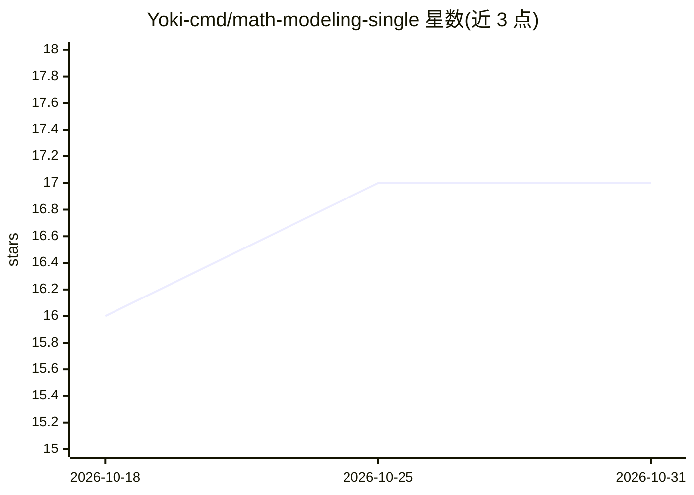

# Yoki-cmd/math-modeling-single

⭐ 17 · Python · 推送 2026-06-23 · [GitHub](https://github.com/Yoki-cmd/math-modeling-single) · 个人维护 · 中文 README

**Claude Code 技能：给一道数模竞赛题，端到端生成可编译 LaTeX 论文**

面向 Claude Code 的数学建模论文生成 skill：输入完整赛题后，在主会话内按国赛标准四阶段流程（策略讨论→代码求解→论文写作→论文审查）执行，MATLAB MCP 跑数据（无则回退 Python 科学栈），统一 xelatex 编译，自带国赛标准回退模板，产出可直接编译的 LaTeX 论文。内置灵敏度分析、5 折交叉验证、数据泄露护栏、三线表 lint 与七维审查等规则层。LaTeX-only 分支不依赖 typst；需将目录复制到 ~/.claude/skills/ 并自备 xelatex 编译后端。

## 筛选速览

| 维度 | 判定 | 备注 |
|---|---|---|
| AI 角色 | `ai-native` | 本体是模型或模型工具 |
| 许可风险 | `none` | — |
| 部署形态 | `None` |  |
| 模型依赖 | — | README 未给出锁定关系 |
| 硬件要求 | — | 无带数字的原话,不猜 |
| 安装摩擦 | `low` | 无编译、无系统依赖或容器化 |
| 成熟度 | — | 结构信号不足 |

## 能力要点

- 四阶段流程全在主会话顺序执行，中间产物 methods.md/solve_data.md 落盘可中断恢复
- MATLAB MCP 求解，不可用自动回退 Python（numpy/scipy/sklearn 等）
- 自带国赛标准 LaTeX 回退模板，xelatex 编译，含三线表生成器与 lint 脚本
- 数据泄露护栏：完美指标即红灯（AUC/F1/R²≥0.99 视为疑似泄露）

## 适用场景

- 数模竞赛（国赛/美赛）队伍从赛题一键生成完整 LaTeX 论文
- 团队统一 LaTeX 工具链、无 typst 环境下跑通论文生成
- 在求解阶段引入灵敏度分析与交叉验证的质量检查

## 场景标签

`编码 Agent` `AI 写作` · 领域:编码与开发

## 证据(README 行号)

> L7: > 给一道数学建模竞赛题，按国赛标准四阶段流程（策略 → 求解 → 写作 → 审查）端到端生成一篇完整论文。主会话顺序内联执行全部阶段，MATLAB MCP 跑真实数据、矢量流程图、自带国赛标准 LaTeX 模板，产出可直接编译的 
> L17: - **四阶段流程**：策略讨论 → 代码求解 → 论文写作 → 论文审查，全程在主会话顺序执行
> L61: 1. 把整个 `math-modeling-single/` 目录复制到 `~/.claude/skills/` 下。

## 星数曲线

2026-10-18 16 → 2026-10-31 17（+1）

---
*卡片 v1 · prompt 1.4 · 生成 2026-10-29 · 置信度 high · 依据 README sha `7d29533e6e0e` · [字段定义](../../DATASET.md)*
