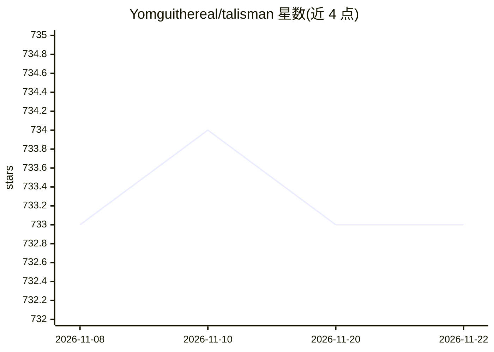

# Yomguithereal/talisman

⭐ 733 · JavaScript · MIT · 推送 2026-11-13 · [GitHub](https://github.com/Yomguithereal/talisman) · [官网](https://yomguithereal.github.io/talisman/) · 个人维护

**JavaScript 的模糊匹配、信息检索与 NLP 算法库**

Talisman 是一个 JavaScript 库，收集模糊匹配、信息检索与自然语言处理领域的算法、函数与构建块，涵盖距离度量（如 Levenshtein、Jaccard）、聚类、去重等。设计上强调模块化按需加载、函数式一致 API、可搭配部分应用与柯里化，支持 Node.js 与浏览器跨平台使用。面向需要在其 JavaScript 应用中直接调用这些文本处理算法的开发者。通过 npm 安装，以 MIT 许可开源，并有 JOSS 论文与完整文档。

## 筛选速览

| 维度 | 判定 | 备注 |
|---|---|---|
| AI 角色 | `ai-native` | 本体是模型或模型工具 |
| 许可风险 | `permissive` | MIT |
| 部署形态 | `library` | 以包/库形式分发 |
| 模型依赖 | — | README 未给出锁定关系 |
| 硬件要求 | — | 无带数字的原话,不猜 |
| 安装摩擦 | `low` | 无编译、无系统依赖或容器化 |
| 成熟度 | — | 结构信号不足 |

## 能力要点

- 提供模糊匹配、信息检索与 NLP 的模块化算法集合
- 函数式一致 API，支持部分应用与柯里化
- 跨平台：Node.js 与浏览器均可使用
- 含聚类等场景的实现与详细文献目录

## 适用场景

- 在 JavaScript 项目中计算字符串相似度（如 Levenshtein、Jaccard）
- 对数据做去重或记录链接
- 构建信息检索或文本分析功能

## 场景标签

 · 领域:NLP/信息检索工具库

## 证据(README 行号)

> L7: Talisman is a JavaScript library collecting algorithms, functions and various building blocks for fuzzy matching, in
> L36: **Talisman** has been published as a paper on the Journal Of Open Source Software (JOSS).

## 星数曲线

2026-11-08 733 → 2026-11-22 733（+0）

---
*卡片 v1 · prompt 1.4 · 生成 2026-11-17 · 置信度 mid · 依据 README sha `4f5d398c933d` · [字段定义](../../DATASET.md)*
